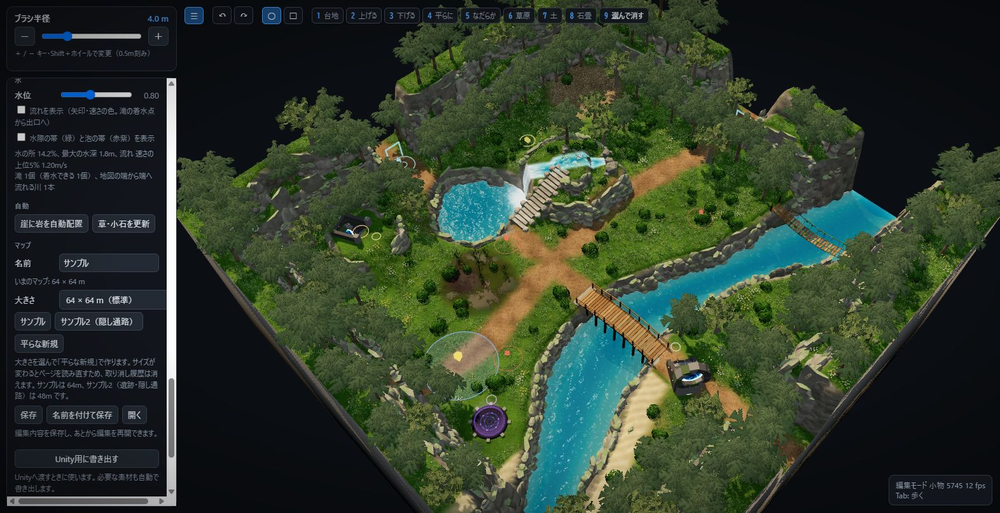
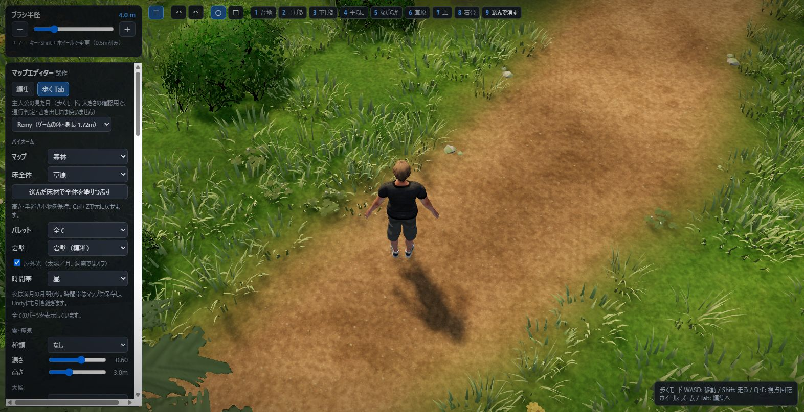

# MapEditor4-3DAPRG

3D アクション RPG 用のマップエディターです。ブラウザで地形・自然物・遺跡・水辺を作り、Remy で歩いて大きさと通りやすさを確認し、Unity 向けのデータを書き出します。

自分専用につくっていて、他の人が使うことは想定しておりません。

**[エディターを開く](https://nishiki-jgg.github.io/MapEditor4-3DAPRG/)** · [基本操作](#基本操作) · [Remy](#remyで歩いて確認する) · [遺跡](#遺跡を組む) · [保存とunityへの受け渡し](#保存とunityへの受け渡し) · [詳しい資料](#詳しい資料)



## できること

- **地形と地面**：台地、上げ下げ、平坦化、なだらかにする編集。草原・土・石畳・砂・岩盤・雪・氷・沼・毒沼・溶岩などの塗り分けと、床全体の塗りつぶし。マップは 24 / 32 / 48 / 64 / 96 / 128m。
- **岩壁と通路**：岩壁の種類を場所ごとに変更。坂・階段・橋・桟橋、隠し通路、曲がり角や分岐のあるトンネルを作成。
- **遺跡**：壁・開口・柱・床・階段・欄干・装飾・控え壁など、30種類の部材を格子と接合で組み立て。
- **自然物と小物**：15バイオームの樹木・草花・岩・洞窟装飾・サンゴ・貝殻・道具などを撒く／置く／調整／削除。宝箱、松明、壁掛け松明、篝火にも対応。
- **水辺**：池・川・海・滝、水源からの小川、四角・丸のプール。海の波、岸の泡、川の流れを表示。
- **光と雰囲気**：昼・夕方・夜（満月）、屋外光の切替、霧・瘴気、風・雨・雪・蛍など。植物の風揺れと、歩くと押し分ける接触表現。
- **ゲーム用設定**：開始地点、出入口、敵・宝箱の候補、戦闘・出現の禁止範囲、階層移動。通行判定の可視化と手動上書き。
- **検証と書き出し**：足場・安全範囲・到達性・橋幅などを検証し、編集データとUnity用データを保存。

## はじめる

1. [公開エディター](https://nishiki-jgg.github.io/MapEditor4-3DAPRG/)をPC版Chrome／Edgeで開きます。リポジトリを一式取得して `index.html` を開くこともできます。
2. 左メニューの「マップ」から「サンプル」「サンプル2（隠し通路）」、または大きさを選んで「平らな新規」を押します。サンプルは64m、サンプル2は48mです。
3. 左のツールを選び、地図上でクリック・ドラッグして編集します。
4. 「歩く」または `Tab` でRemyを動かし、通路・段差・配置の大きさを確認します。
5. マップに名前を付けて「保存」。Unityへ渡すときは別途「Unity用に書き出す」を使います。

素材・サンプルの準備中は進捗が表示されます。固定サンプルには処理済みデータがありますが、環境や再計算の条件によって待ち時間が発生します。[読込の仕組みと確認範囲](docs/PREPARED_SAMPLES.md)

## 基本操作

| 操作 | PC |
|---|---|
| 編集 | 左クリック・ドラッグ |
| 視点の回転／移動／ズーム | 右ドラッグ／中ドラッグ／ホイール |
| 移動 | `W` `A` `S` `D` |
| 編集／歩くの切替 | `Tab` |
| 歩くモードで速く移動 | `Shift` |
| 取り消し／やり直し | `Ctrl+Z`／`Ctrl+Y`、上部の `↶`／`↷` |
| 保存／名前を付けて保存 | `Ctrl+S`／`Ctrl+Shift+S` |
| メニューの表示切替 | 上部の `☰` |
| ブラシの形 | 上部の `○`／`□` |
| ブラシ半径 | 左上のスライダー・＋／−、`Shift+ホイール` |
| ブラシ設定の呼び出し／登録 | `1`〜`9`／`Shift+1`〜`9` |

歩くモードでも左クリックで編集できます。見て回るつもりのクリックで地形を変えないよう注意してください。

ブラシのスロットはツール・種類・半径・強さ・密度・形・選択した小物を記憶します。右クリックで登録を解除できます。スロットとメニューの開閉状態はブラウザ内に保存され、マップの保存データには入りません。

### スマホ・タブレット

- 「歩く／編集」ボタンで切り替えます。メニューは `☰` で開きます。
- 歩くモードでは左下のスティックで移動、右下の「走る」で速度切替。画面をなぞって視点を回し、2本指でズームします。
- 編集モードでは1本指で編集、2本指でズーム・回転・移動します。
- 「⟲ 縦横」は対応端末では全画面・向き固定、非対応端末ではページを回転します。

フォルダへの直接書き出しはPC版の対応ブラウザを使ってください。[タッチ操作の詳細](docs/REVISION_21_NOTES.md)

## Remyで歩いて確認する

Remyは、**ゲームの主人公と同じ大きさでマップを見て回るための確認用キャラクター**です。MixamoのRemyを使用し、身長は約1.72m（データ上1.719m）です。



- 「主人公の見た目」で **Remy（ゲームの体）** と **簡易の人形** を切り替えられます。Remyが読み込まれると既定の見た目になります。
- 停止・歩き・走りの動きがあり、実際の移動速度に合わせてアニメーション速度を調整します。
- 通路の幅、天井の高さ、段差、小物との大きさの関係を目で確認できます。
- **Remyの見た目と通行判定の体格は別です。** 通行判定は「体格」の半径・身長・最大傾斜・段差・最大水深などを基準にします。Remyへ切り替えても、これらの数値は変わりません。
- **RemyのモデルやアニメーションはUnity用マップ出力に含みません。** 見た目の切替はマップの保存内容にも影響しません。

データの構成、動き、生成方法、確認用テストは [hero/README.md](hero/README.md) を参照してください。

## 遺跡を組む

1. ツールの「遺跡を組む」を選び、「部材」で使う構造を選択します。
2. 寸法・仕上げ・向きを設定して配置します。「0.5m格子を表示」で地面や高床に沿った格子を確認できます。
3. 壁をつなぐときは「パーツを接合（直線・直角）」をONにし、相手の端へ近づけ、**「直角の壁端に一致」などの案内を確認してから配置**します。直角接合は同じ高さ・壁高で直交する対応部材が対象です。格子ONだけでは接合しません。
4. 編集・削除は「地図で選択（削除・編集）」をON → 部材をクリック → 黄色枠を確認。「選択を削除」または「選択を移動」を使います。新規配置に戻るときは「新しく配置」を選びます。

格子吸着は部材の接合点が基準です。部材の中心が格子交点にない場合も正常です。支持床など、他の部材から参照される構造は削除できない場合があります。

[配置・選択・削除・接合の詳細](docs/RUINS_EDITOR_CONTROLS.md) · [30種類の統合と対応範囲](docs/RUINS_INTEGRATION_20261106.md)

## 保存とUnityへの受け渡し

### 編集を再開するための保存

- 「保存」「名前を付けて保存」で圧縮形式の **`.map`** を保存し、「開く」で再編集します。旧JSONも読み込めます。
- PC版Chrome／Edgeでは「名前を付けて保存」で保存先を選べます。選択後の「保存」は同じファイルを上書きします。非対応ブラウザではダウンロードします。
- マップ名はファイル名やUnity出力の `meta.json` の `mapName` に使われます。

### Unityへ渡す

1. 「Unity用に書き出す」を押し、保存先フォルダを選びます。
2. 部屋ごとの編集データ・Unity用ZIPと、必要な共通素材が保存されます。新規・変更素材だけを追加し、旧部屋が使う素材の版を維持します。
3. **部屋フォルダと `_shared` を一緒に保管・受け渡し**します。部屋のZIPだけでは素材が不足する場合があります。

個別のZIPが必要な場合は「詳細な書き出し」を使います。編集保存とUnity用書き出しは別操作です。

[素材の自動同期・取り込み](docs/ASSET_REGISTRY.md) · [部屋フォルダの受け渡し](docs/ROOM_FOLDER_WORKFLOW.md) · [共通素材ZIP・旧形式の変換](docs/ROOM_PACKAGE_STORAGE.md)

### 主な出力データ

| データ | 内容 |
|---|---|
| `heightmap_r16.raw` / `walk_floor_r16.raw` | 地形／歩行床の高さ |
| `weights_*.png` / `mask_*.png` / `cliff_style.png` | 地面の塗りと岩壁の種類 |
| `walkable.png` / `holes.png` | 通行判定と地形の穴 |
| `secret_passages_mesh.json` / `tunnels_mesh.json` | 隠し通路・トンネルの形状 |
| `ruins_structures.json` | 遺跡構造（遺跡を含むマップ） |
| `water_*` / `sea_field.png` / `spring_*` | 水・海・水源の情報（該当する場合） |
| `props.csv` / `asset_catalog.json` | 小物の配置と資産の対応 |
| `meta.json` | 座標系、体格、マーカー、構造物、天候・時間帯など |
| `validation.json` / `manifest.json` | 検証結果とファイルのハッシュ |

座標はUnityの左手系、原点は地形の角、Yが上です。正確な形式は出力内の `README.txt` と `meta.json` を参照してください。共有素材は別管理で、必要なレシピと素材を取り込み時に復元します。

### Unity側の確認範囲

ブラウザでの表示・検証合格と、ゲーム本体での取り込み・移動の完成は別です。水・共有小物・遺跡などには個別のUnity用実装と検証記録がありますが、任意のマップの全要素が本体へ一括で復元できる保証ではありません。

遺跡の同梱ImporterはUnity Terrain方式です。ゲーム本体のMesh方式Importerとは接続方法が異なります。導入時は各資料の対応範囲を確認してください。

## 詳しい資料

変更履歴や個別の検証結果は、機能別の資料にまとめています。各資料に書かれたモデル数や検証結果は、その更新時点の記録です。

- **遺跡**：[操作](docs/RUINS_EDITOR_CONTROLS.md)、[統合](docs/RUINS_INTEGRATION_20261106.md)
- **主人公**：[Remyの構造・動き・生成](hero/README.md)
- **地面・岩壁**：[地面と自然物](docs/SOIL_POLISH.md)、[崖岩の密着・保存・出力](docs/CLIFF_CONTACT.md)
- **樹木**：[樹冠](docs/TREE_CANOPIES.md)、[根と樹皮](docs/ROOT_BARK_POLISH.md)、[龍血樹](docs/DRAGON_REFERENCE.md)、[実用配置](docs/NATURE_SCENE_POLISH.md)
- **草花・林床**：[植物セット](docs/PLANT_SET.md)、[形状](docs/PLANT_POLISH.md)、[風と接触](docs/PLANT_MOTION.md)、[強風](docs/PLANT_GALE.md)、[林床](docs/FOREST_FLOOR_POLISH.md)、[下草](docs/UNDERSTORY_SET.md)、[花畑](docs/FLOWER_MEADOW.md)、[倒木・柵](docs/PROP_REFINE.md)
- **洞窟・小物**：[洞窟装飾](docs/CAVE_DECOR.md)、[宝箱](docs/CHEST_RELEASE.md)、[壁掛け松明](docs/WALL_TORCH.md)、[炎と篝火](docs/FIRE_FIXTURES.md)
- **水辺**：[水源とプール](docs/REVISION_28_NOTES.md)、[滝](docs/REVISION_29_NOTES.md)、[海](docs/REVISION_18_NOTES.md)、[川と河口](docs/REVISION_24_NOTES.md)、[桟橋とサンゴ](docs/REVISION_25_NOTES.md)、[貝殻と海藻](docs/REVISION_26_NOTES.md)
- **トンネル**：[基本](docs/REVISION_30_NOTES.md)、[入口と地面](docs/REVISION_33_NOTES.md)
- **読み込み**：[固定サンプル](docs/PREPARED_SAMPLES.md)、[準備と待ち時間](docs/SAMPLE_PREPARATION.md)

## 開発・テスト

- `index.html` / `app.js`：UIとエディター本体
- `ruins.js` / `ruins-surface.js`：遺跡構造と表面
- `props/`：小物と共有部品（[追加・修正方法](props/README.md)）
- `hero/`：Remyの見た目とアニメーション
- `water.js` / `sea.js` / `springs.js` / `tunnels.js`：水・海・水源・トンネル
- `map-storage.js` / `map-package.js` / `asset-registry.js`：編集保存・パッケージ・素材台帳
- `prepared/` / `samples/`：処理済みサンプルとサンプルデータ
- `unity/Assets/`：Unity側のBuilder・Importer・Shader
- `tests/` / `docs/`：検査スクリプトと機能別の検証記録

Node.jsで実行する代表的な検査：

```sh
node tests/ruins-contract.cjs
node tests/ruins-integration.cjs
node tests/ruins-editor-controls.cjs
node tests/ruins-corner-snap.cjs
node tests/water_unit.js
node tests/tunnels_unit.cjs
node tests/springs_unit.cjs
```

ブラウザを使う検査は、各スクリプト冒頭の必要環境を参照してください。Remyの確認は `node tests/hero_view.js <出力フォルダ>`。Playwright使用の検査と、Chrome／Edgeを直接使う `tests/cdp.js` 系の検査があります。個別テストの合格を全機能・全端末の検証完了とは扱いません。

画面画像は2026-11-07に現行の公開エディターを撮影したものです。
