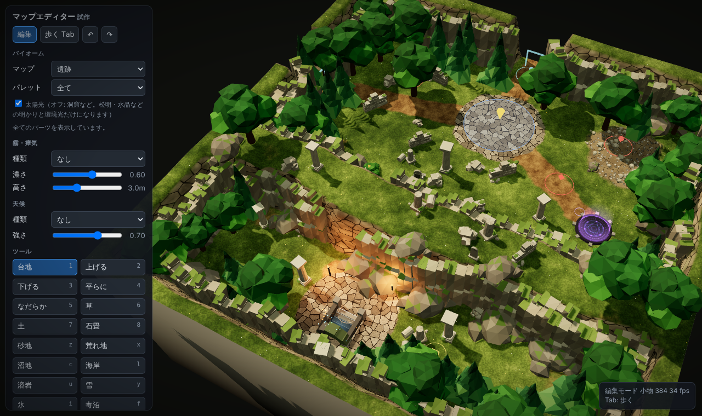

# MapEditor4-3DAPRG

固定サンプルは処理済みの崖岩・通路・衝突情報を同梱し、キャッシュのない端末でも完成品から読み込みます。[同梱データ・初回復元](docs/PREPARED_SAMPLES.md)。新しいランダム生成や編集時の計算とは分離しています。[読込の改善・検証・残る待ち時間](docs/SAMPLE_PREPARATION.md)。

樹木・木質低木24モデルの根元と幹を改善しました。細い棘状の根を根張り・厚い主根へ変え、9系統の樹皮と緩斜面の根元補正を共用しています。[根と幹の確認](tests/tree_roots_view.html) / [比較・負荷・検証](docs/ROOT_BARK_POLISH.md)。

龍血樹を実物の参照写真と照合し、反復分岐と浅い連続天蓋へ修正しました。[真上](tests/tree_view.html?id=dragontree) / [低い視点](tests/tree_view.html?id=dragontree&view=low) / [変更と検証](docs/DRAGON_REFERENCE.md)。

シダ・つる茂み・地這いツタを磨き込み、3種合計で48三角形を削減しました。シダの風・接触も共有GPU方式へ揃えています。[林床の確認](tests/forest_floor_view.html) / [改善と検証](docs/FOREST_FLOOR_POLISH.md)。

ユーカリ・龍血樹の葉塊と、エルフの木・世界樹の根元を磨き込みました（96種を維持）。[4つの実用配置](tests/nature_scene_view.html) / [改善と負荷・検証](docs/NATURE_SCENE_POLISH.md)。

紅葉・桜・ケヤキ・ナラ・スギ・ヒノキ・シマトネリコ・オリーブ・ユーカリ・龍血樹・エルフの森の木・世界樹を追加し、既存の木も樹冠・色・影・風を改善しました（計96種）。[木の確認一覧](tests/tree_view.html) / [寸法・負荷・検証](docs/TREE_CANOPIES.md)。


倒木・切り株・露出根・流木・木の柵を磨き込み、寸法を保ったまま三角形を削減した。[確認一覧](tests/prop_refine_view.html) / [変更と検証](docs/PROP_REFINE.md)。

花畑を白・黄・桃・赤・青紫の5色で配置できる。色を並べたり混ぜたりして配色を作れる。[一覧と配置例](tests/flower_meadow_view.html) / [使い方と検証](docs/FLOWER_MEADOW.md)。
[林縁と地被の自然物5種](docs/UNDERSTORY_SET.md)を追加し、既存キノコとスゲ・ロゼットも改善しました。最新mainの崖5種を含む既存74種を維持して計79種です。[新しい一覧プレビュー](tests/understory_view.html)で真上の形・大きさと風・接触を確認できます。

3D アクション RPG 用のマップエディターです。ブラウザで地形・地面・小物・橋・階段・隠し通路・ゲーム用マーカーを作り、Unity にそのまま取り込める形で書き出します。
自分専用につくっていて、他の人が使うことは想定しておりません。



真上向けの植物10種を追加しました（計69種）。[一覧プレビュー](tests/plant_set_view.html) と [寸法・予算・検証](docs/PLANT_SET.md) を確認できます。

草・下草の輪郭と枝への接続、柳の葉模様を[同じポリゴン予算で改善](docs/PLANT_POLISH.md)しました。

追加10種にも[風と接触揺れ](docs/PLANT_MOTION.md)を実装しました。本体は天候「そよ風」などで風が有効、歩くモードで低い枝葉を押し分けます。一覧の「風」「接触テスト」でも確認できます。

「強風」の風下へのしなりと突風、鈴花の茎・花・低い葉、シダの風を[本体の通常距離で調整](docs/PLANT_GALE.md)しました。

## 使い方

1. `index.html` をブラウザ（Chrome 推奨）で開きます。インストールもサーバーも要りません。
2. 左のパネルでツールを選び、地図の上でクリック・ドラッグして編集します。`Tab` で「歩くモード」に切り替わり、キャラクターを WASD で動かせます。歩くモードでも、左のパネルと左クリックで、そのまま編集できます。
3. 「マップ」欄の「名前」にマップ名を入れると、タブの題名・保存のファイル名・書き出しの zip 名（`<名前>_export_unity.zip`）になります。マップ名は保存データと書き出しの `meta.json`（`mapName`）にも入ります。
4. 「保存 (JSON)」（`Ctrl+S`）で `<名前>.json` を保存し、「読み込み」で戻せます。
   - 「名前を付けて保存」（`Ctrl+Shift+S`）：Chrome・Edge では保存先とファイル名を選べます。その後の「保存」は、同じファイルへの上書きになります（保存先は「マップ」欄に表示）。
   - 保存先を選べないブラウザでは、名前を聞いてダウンロードします。
5. 「Unity用書き出し (zip)」で Unity 向けのデータ一式を書き出します。書き出しの前に検証が走ります。

地図の上のバー（左のパネルの右）：

- `☰`：左のメニュー（ブラシ半径の欄も）をしまう・出す。しまうと、地図を画面いっぱいに使えます。開け閉めの状態は、このブラウザに保存されます。
- `↶` `↷`：取り消し・やり直し（`Ctrl+Z` / `Ctrl+Y` でも同じ）。パネルをスクロールしても、いつも見えています。
- `○` `□`：ブラシの形（円・四角）。地形・地面の塗り・岩壁を塗る・通行判定の塗り・小物を撒く／消すに効きます。四角は地図の縦横にそろい、半径は四角の辺の半分です。
- `1`〜`9`：ブラシのスロット。キーの `1`〜`9` かボタンのクリックで、登録した設定を呼び出します。
  - 登録：`Shift+1`〜`9`（または `Shift`+クリック）。いまのツール、その種類（橋・階段・置く物など）、半径・強さ・密度・形、チェックした小物をまとめて覚えます。
  - 右クリックで登録を消します。登録していない番号は、これまでどおりのツール（1＝台地 … 9＝小物を撒く）です。
  - 登録は、このブラウザに保存されます（地図の保存データには入りません）。

小物の種類と「置く」ツールの置く物は、木・倒木／草花・低木／岩・崖／遺跡・墓／建物・道具（と、新しく足した物の「その他」）のグループに分かれ、たたんで表示できます。グループの見出しのチェックで、そのグループを全部入れる・外すことができます。右の数字は「チェックした数／表示中の数」です。

森林・草原の地面、針葉樹と共有自然物を改善しました。画像の由来、軽さの予算、Unityでの取り込み、検証範囲は [地面と自然物の更新](docs/SOIL_POLISH.md) を参照してください。

### スマホ・タブレット

タッチ操作の端末（スマホ・タブレット）でだけ、次のボタンが出ます。PC では出ません（`docs/REVISION_21_NOTES.md`）。

- 左のメニューは、最初はしまってあります（`☰` で出す）。1〜9 のスロットのボタンは出しません。
- `歩く`／`編集`（上のバー）：モードの切り替え（PC の `Tab` と同じ）。
- 歩くモード：左下の**スティック**で移動（倒す量で速さが変わる）、右下の**走る**ボタンで走る・歩くを切り替え、画面をなぞると視点が回り、2 本指でズーム。
- 編集モード：1 本指で編集（少し置いてから始まる）、2 本指でズーム・回転・移動。
- 右上の `⟲ 縦横`：画面の縦と横を切り替え。
  - Android の Chrome などは、全画面にして画面の向きを固定します。もう一度押すと元に戻ります。
  - iPhone の Safari のように向きを固定できないブラウザでは、ページそのものを 90° 回して表示します（スマホを左に倒して横向きで持つ）。

## 主な機能

- **地形**：台地・上げる・下げる・平らに・なだらか。部屋の大きさは 24 / 32 / 48 / 64 / 96 / 128m から選べます。
- **地面**：土・石畳・砂地・荒れ地・沼地・毒沼・溶岩・雪・氷・海岸
- **海**：「海岸」ツールの海と「浜辺・磯」では、地図の端につながる水が海になり、波が岸へ寄せて砕け、砂浜を駆け上がって引きます。風で波が高くなります。浅瀬は澄んだエメラルドで、海底に光の網目が揺れ、泡はレース状に流れます（`docs/REVISION_18_NOTES.md`）。囲まれた池や湖は静かなままです。地図の端や海につながっていても、幅がおよそ 8m より細い水路は川になり、海へ流れます（`docs/REVISION_23_NOTES.md`）。波の山は海岸を波長ほどの幅でならした線に沿い、河口の前でもまっすぐ通ります。河口では川の流れが波を押し返し、波は川へ入り込みません（`docs/REVISION_24_NOTES.md`）。Unity でも、書き出しの `sea_field.png` と `meta.sea` から同じ海を作れます（`MapWaterBuilder`。海の式は `sea.js` の 1 か所だけで、Unity 用の HLSL は `node tools/sea/build-sea-hlsl.cjs` で作ります）。
- **岩壁**：標準・土壁・黒い岩壁・濡れた岩壁・苔むした岩壁・砂漠の岩壁・雪山の岩壁。マップ全体の既定を選べるほか、「岩壁を塗る」ツールで場所ごとに塗り分けられます。
- **構造物**：坂、階段（4 種）、橋（7 種）と桟橋（陸から水の上へ。`docs/REVISION_25_NOTES.md`）、滝
- **水源とプール**：「水源」ツールでクリックした所から水が湧きます。湧出量は 4 段階（しずく・小川・泉・大きな泉）。水は低い方へ小川になって流れ（川床の溝は自動で掘ります）、平らな所では湧出量に合った広さまで広がって止まり、くぼみは池になって、満ちるとあふれて流れ続けます。「プール」ツールでは、石の縁で囲んだ四角・丸のプールを地面の上に作れます。中に水源を置くと、あふれ口から小川が流れ出ます。小川が崖を落ちる所は、崖の縁から滝つぼへ落ちる滝になります（`docs/REVISION_29_NOTES.md`）。流体のシミュレーションはせず、一度だけ計算した静的な水なので、スマホでも軽く動きます（`springs.js`、`docs/REVISION_28_NOTES.md`）。
- **水の流れ・泡**：滝の着水点から出口への流れ、滝の無い川の流れ、泡の帯を自動で計算します。「水」の欄で、流れの矢印と泡の帯を表示できます（`water.js`）。
- **植物の揺れ**：歩くモードで、茂み・シダ・葦・花・草むらに主人公が触れると、押しのけられて傾き、離れると揺れながら元に戻ります。見た目だけで、通行判定・書き出しには関わりません（`docs/REVISION_14_NOTES.md`）。
- **主人公の見た目**：歩くモードの主人公を、ゲーム用の体（Remy、身長 1.72m）にしました。歩く・走る動きが付いています。マップの大きさを、ゲームと同じ大きさの体で確かめられます。簡易の人形にも切り替えられます。見た目だけで、通行判定・書き出しには関わりません（`hero/`）。
- **小物**：15 バイオーム分のパーツ。浜辺の水の中には、コーラル 6 種（ノウサンゴ・枝状ミドリイシ・ハシラサンゴ・ウミウチワ・テーブルサンゴ・丸いサンゴの群体）を撒けます（`docs/REVISION_25_NOTES.md`）。波打ち際には、ホタテの殻・タカラガイ・貝のかけら・打ち上げられた海藻を撒けます。海岸ツールで浜を作ると、貝殻だけが自動で少し並びます（`docs/REVISION_26_NOTES.md`）。撒く・置く・消す・選んで消す。植物は葉の形が見える低ポリゴン、岩は割れ面のある形、壁は石積みで作っています（`docs/REVISION_9_NOTES.md`）。1 種類ずつ `props/` の別ファイルなので、個別に直したり差し替えたりできます
- **通行判定**：自動判定の表示と、手動での上書き（通行可・通行不可・隠し通路）。体の大きさなどの体格も設定できます。
- **ゲーム用マーカー**：出入口、敵・宝箱の候補、戦闘・出現の禁止範囲、開始地点
- **階層移動**：魔法陣・上り階段・下り階段（旅の扉のゲート付き）
- **雰囲気**：霧・瘴気などの空気、天候（雨・雪・砂嵐・蛍など）、太陽光のオン・オフ。太陽光オフ（洞窟など）のときは、明るさを「暗い（明かりだけ）」「ふつう」「明るい」の 3 段階から選べます。
- **検証**：足場・安全範囲・到達できるか・橋の幅・隠し通路の形などを、書き出しの前に検査します。

## Unity 向け書き出し（zip）

主なファイル：

| ファイル | 内容 |
|---|---|
| `heightmap_r16.raw` / `walk_floor_r16.raw` | 地形の高さ / 歩く床の高さ（16bit。Unity Terrain が受け付ける解像度 65 / 129 / 257） |
| `weights_*.png` / `mask_*.png` | Terrain Layer の重み / 塗りの元データ（ゲーム判定用） |
| `walkable.png` | 通行判定（補間しないこと） |
| `holes.png` / `secret_passages_mesh.json` | 地形の穴 / 隠し通路の床・壁・天井 |
| `cliff_style.png` | 岩壁の種類（場所ごと） |
| `water_flow.png` / `water_mask.png` | 水の流れ・流れ関数・岸からの距離 / 泡の帯（`meta.waterSim` に説明。水が無い・海・溶岩の時は出ません） |
| `spring_water.png` / `spring_flow.png` / `spring_mask.png` | 水源の小川・池・プールの水面の高さと種類 / 流れ / 滝つぼからの泡の帯（`meta.springs`・`meta.pools` に説明。水源かプールがある時だけ） |
| `shared_props.json` / `pine_wind.json` / `shared_ground.json` | 共通小物・針葉樹の風・草と土の画像と材質設定（任意の追加出力） |
| `props.csv` / `asset_catalog.json` | 小物の配置 / 資産名と当たり判定の対応表 |
| `meta.json` | 座標の決まり、マーカー、階層移動、橋・階段、水、天候など |
| `validation.json` / `manifest.json` | 検証結果 / 各ファイルの SHA-256 と contentHash |

座標の決まり：Unity の左手系、原点は地形の角、Y が上。詳しくは書き出しの `README.txt` と `meta.json` の `coordinateSystem` を見てください。

## フォルダー構成

```
index.html, app.js      エディター本体
props/                  小物（1 種類 1 ファイル）、共通の部品 common.js、葉と樹皮のテクスチャ foliage.js、岩肌のテクスチャ detail.js。直し方は props/README.md
hero/                   主人公の体（見た目だけ）。Remy のデータ remy.js と、それを作る Blender のスクリプト。直し方は hero/README.md
water.js                水の流れ・泡の計算（画面に依存しない。node でも動く）
springs.js              水源の水（小川・池・あふれ）の計算と、川床の溝（画面に依存しない。node でも動く）
three.min.js            three.js r160（MIT License）
samples/                書き出しのサンプル（通常サンプル 64m / 隠し通路サンプル 48m）
docs/                   修正報告（REVISION_3〜29）と画像
tests/                  受け入れテスト（Playwright、水は Chrome の CDP）と、その結果
unity/Assets/MapWater/  Unity 側の水（書き出しから水面・滝・飛沫・波紋を作る。docs/REVISION_8_NOTES.md）。海は MapWater/Sea（エディターと同じ式。docs/REVISION_19_NOTES.md）
```

## テスト

`tests/` のスクリプトは Playwright（Chromium）でエディターを開いて検査します。

```
PW=<playwright のパス> node tests/rev5_terrain_grid.js
```

- `rev3_acceptance.js`：ハッシュ・資産対応表・Prefab の向き・橋・安全範囲・不正値
- `rev4_acceptance.js`：橋・階段の幅、yawOffset、壊れたデータの拒否
- `rev5_terrain_grid.js`：全サイズの Terrain 解像度、隠し通路と穴の一致
- `sample2_secret.js`：隠し通路サンプルの検証
- `strandline.js`：波打ち際の小物（海岸ツールで貝殻が自動で並び、海藻は自動では置かない、高さの帯、池には置かない、やり直しても増えない）
- `pier_coral.js`：桟橋（陸から水の上へ、床の高さ、先まで歩ける、検証・書き出し）とコーラル（水の中にだけ撒ける、海岸ツールで消えない、保存・書き出し）
- `sea_river.js`：海につながる細い水路は川（海の重み 0、海へ流れる）になり、河口でなめらかに替わる。波の山は川へ入り込まず、川の流れに押し返される。書き出しに海と川の両方が入る
- `sea_shore_seam.js`：海岸の境目（陸と水の中の砂がつながる・水際に黒いにじみが無い・波の届かない浜に水面の板が何も描かない）
- `springs_editor.js`：水源（低い方へ流れて溝を掘る・くぼみが池になる・平らな所は湧出量の広さ・深い池は歩けない・湧出量を変えても消しても地面が元に戻る）とプール（床が平ら・水は縁の 10cm 下・縁は通れない・あふれ口から小川）、取り消し・保存・書き出し
- `spring_falls.js`：水源の滝（崖の面に水の板を貼らない・幕は滝つぼから縁まで・崖石を片づける・波紋）と、置いた滝が地形を掘る・埋めると水面や地面に付き直すこと
- `mobile_walk.js`：スマホ・タブレットの操作（メニューの出し入れ・スティック・走る・縦横・指での編集）と、PC でボタンが出ないこと

水の試験は、Playwright なしで Chrome（または Edge）を直接動かします（`tests/cdp.js`。場所は環境変数 `BROWSER` でも指定できます）。

- `node tests/hero_view.js <出力フォルダ>`：主人公の体（大きさ・向き・透かし・切り替え・書き出しが変わらないこと）と画像
- `node tests/water_unit.js`：`water.js` の単体試験
- `node tests/springs_unit.cjs`：`springs.js` の単体試験（平地・斜面・くぼみ・あふれ・合流・水際・プール・溝・同じ結果・速さ）
- `node tests/water_export.js <元のエディターの写し>`：水の書き出しの中身、node との再現性、既存ファイルが変わらないこと
- `node tests/water_view.js <出力フォルダ>`：画面の水の表示を画像にする
- `node tests/water_perf.js`：128m の部屋での水の計算時間
- `node tests/export_to_folder.js <出力フォルダ>`：サンプルを書き出してフォルダへ展開する（Unity の試験の入力）

## 確認の範囲

エディター側の動作と書き出しデータは、上記のテストで確認しています。Unity 上での取り込み・描画・当たり判定・移動は、まだ確認していません。ただし水だけは、試験用の Unity プロジェクトで描画を確かめました（`docs/REVISION_8_NOTES.md`）。

崖の自動配置岩の密着・保存・出力については[仕様と確認範囲](docs/CLIFF_CONTACT.md)を参照してください。

## 部屋ZIPの容量

部屋の保存は共通資産を分離した可逆圧縮版です。共通ZIPは初回・素材更新時に1個保存します。[保存方法・旧ZIP変換・Unity取り込み](docs/ROOM_PACKAGE_STORAGE.md)。

凸ダン向けの保存は「凸ダン用フォルダへ保存（素材も自動同期）」を推奨します。新規・変更素材だけを共通資産庫へ保存し、旧部屋の参照を維持します。[素材台帳と取り込み](docs/ASSET_REGISTRY.md)。
