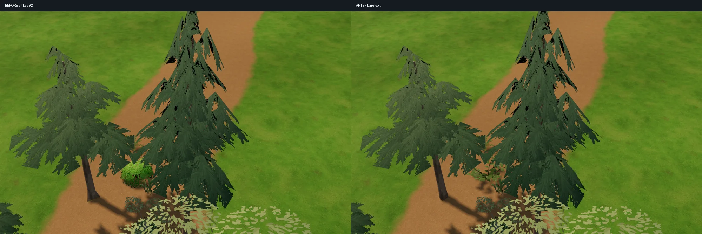
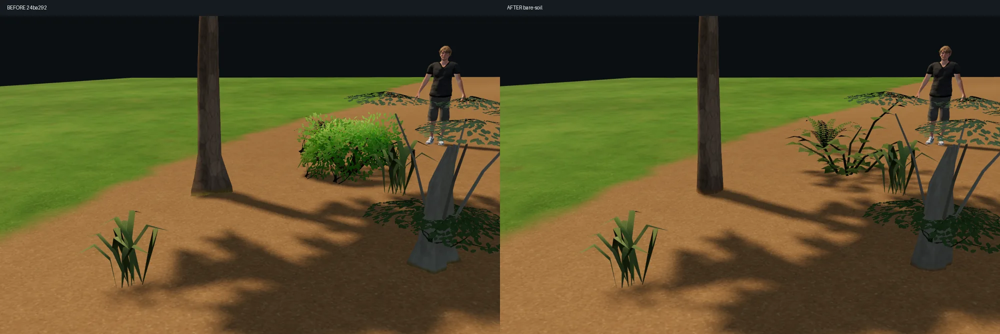
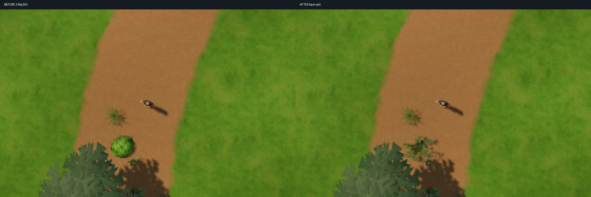
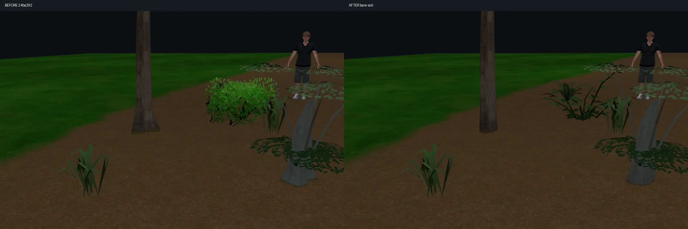

# 裸地での樹木・茂みの接地

24ba292 の実装を基準に、土道で針葉樹の裾が三角形のスカートに見えること、根元に草色が残ること、既存の茂みが明るい塊として地面から浮いて見えることを改善しました。

## 変更

- 根幹24種の根張りを再調整。通常木の裾の強い三つ山を取り除き、裾に残っていた大きな上向き法線補正も弱めました。大型幻想樹の板根と龍血樹の分岐・天蓋は保全しています。
- 根元が参照する土の量を、株元の一値から、実際の描画位置のペイントへ変更。地面と同じノイズ・閾値で土の被覆を求め、土が十分に塗られた場所に草色や苔色を残しません。土の地面材質や照明は変更していません。
- 既存 ID `bush` を共有メッシュ化。縦の交差カードから、根元につながる7本の枝と小さな曲げ葉へ変更しました。葉色の明暗を抑え、下部にも葉を分散。原点、旧配置範囲、接地オフセット、カタログ順を保持しています。
- 根元の小さなクリップと影の輪郭を一致させ、既存の根の地形追従・風・接触を保全しました。丸い影シール、透明な地面パッチ、地形の一括変更は加えていません。

根幹の対象は pine、birch、willow、scotspine、hazel、rowan、juniper、maple、cherry、zelkova、nara、sugi、hinoki、islandash、olive、eucalyptus、dragontree、elftree、worldtree、oak、palm、banana、deadtree、twisttree です。

## 同一条件の比較

左が24ba292、右が今回。実エディタで同じ地形・土道・配置・カメラ・照明を再現した静止画です。ユーザー PC の Chrome で撮影しました。添付画像そのものの再現一致を示すものではありません。[比較画像ページ](../tests/bare_soil_compare.html)でも確認できます。

[操作できる裸地確認ページ](../tests/bare_soil_view.html) は実エディタを使用します。裸の土・土道・土草境界、太陽、10%斜面、0.65/1/1.35倍、隣接配置を切り替えられます。このページだけ静止比較にしています。本体の風を無効化する変更ではありません。

裾の鋭い張り出しと緑の縁、茂みの明るい塊は減りました。一方、低視点では幹と土の材質境界がまだ読め、葉は低ポリの面として見えます。太陽なしでの実時間の接触陰影・SSAOを追加したわけではなく、美観が完全に解消したとはしていません。

## 負荷と共有経路

| 項目 | 変更前 → 今回 |
|---|---|
| カタログ | 96 → 96、既存 ID と順序を保持 |
| 共有モデル | 49 → 50、既存 bush の変換 |
| 根幹24種の三角形合計 | 17,365 → 17,365 |
| bush | 76 → 479三角形、1材質、透過カードなし |
| 共通画像 | 7枚をバイト単位で保全、新規アトラスなし |
| 根元の描画・影パス | 追加なし |

ブラウザでは既存の舗装用 RGBA マスクの未使用 B/A に土・瓦礫の量を入れます。R/G の舗装・余白は保全。新しいマスク画像の割当はありませんが、根元用のサンプラー1個と該当部分のテクスチャ参照が増えます。土編集時も既存マスクを更新します。茂みの三角形は増えるため、透過重なりを削ったことだけで描画が速くなるとは判断していません。

比較した土道9配置では、`renderer.info.render` の描画呼び出しは前後とも18、三角形は105,934→106,337でした。増分403は茂み1株です。この値はその場面の描画統計であり、全マップの負荷上限やフレーム時間ではありません。比較WebP4枚は計362,774バイトで、比較ページ専用です。

Unity には同じペイントを任意の `root_paint.png` と `root_grounding.json.paint` で渡します。PNG は R=土、G=瓦礫、A=255。生データとして linear・bilinear・clamp、ミップなし・非圧縮・NPOT変更なしで一度取り込み、共有材質から参照します。64m/129角の例はGPU上で66,564バイト、最大1025角なら約4MiBです。ブラウザのマスクとPNGの上下方向差を変換しています。旧エクスポートにペイントがなければ従来の株元値へ戻ります。マップJSON・CSVの保存形式は変更していません。

新しい50モデルのエクスポートには、今回更新したUnityキットを使ってください。旧キットの49モデル固定検査では拒否されます。更新キットは旧49モデルの `shared-plants/7` と、既存ID bush を含む50モデルの両方を受け付けます。旧マップの読み込み互換と、旧キットで新エクスポートを扱えることは別です。

## 検証

- `tests/bare_soil_source.py`：1,863項目。24種の形状範囲・固定根幹・樹冠保全、既存モデルと7画像の保全、bush の旧範囲・有限値・根元固定を確認。
- `tests/bare_soil_browser.cjs`：9対象×太陽2条件×歩行/真上の36場面、斜面・隣接・境界・大小縮尺8条件、旧マップの位置・回転・縮尺・bush 接地位置の再読込。
- 根幹の配置・選択・回転・削除・保存読込、GPU変形、地形追従と影の検査。共有資産の再生成一致を確認。
- 本体の風・接触検査は bush を含む25対象。無風・そよ風・強風、固定根元、押し方向、変位上限、離脱復帰、CPU頂点更新なしを確認。
- 舗装用マスクのR/G・土瓦礫B/A、変更のない再アップロード抑制と、既存の舗装・崖表示を回帰確認。
- 隔離Unity 6000.5.9f1/URP/D3D11：327項目、根元材質のGPU照合173項目、裸地共有材質・50モデル/8配置の取り込み・7対象の太陽オン/オフ撮影10項目を通過。旧v2〜v7形式、風接触・復帰、影、根の地形追従を確認。撮影用照明はシャドウバイアスを明示し、既定値による影の離れを抑えました。ゲーム本体へは組み込んでいません。

接触CPU検査は484配置・2,400更新で平均0.00358ms/更新、距離候補最大23でした。ユーザー PC の Chrome、ソフトウェアWebGL環境での接触処理のみの値です。描画速度・スマホ実機性能を保証する値ではありません。

## 制限

地形追従は局所平面の近似です。急斜面や大きな非平面地形、極端な非均一拡縮では完全に埋まりません。小縮尺の枝下高さ、幹中心の簡易当たり判定と広い根の差も継続課題です。スマホ実機、ゲーム本体統合、Unity Built-in経路は未検証。既知のUnity D3D12終了時クラッシュの原因は未確定です。水・主人公・花畑配色・保存IDは本件の変更対象外です。
