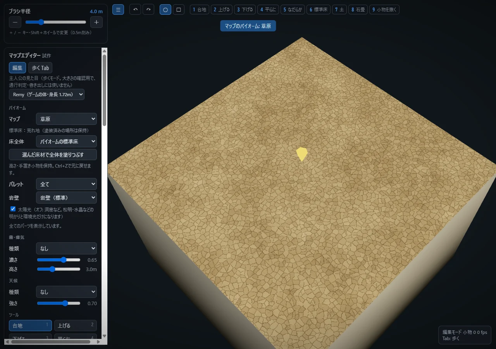
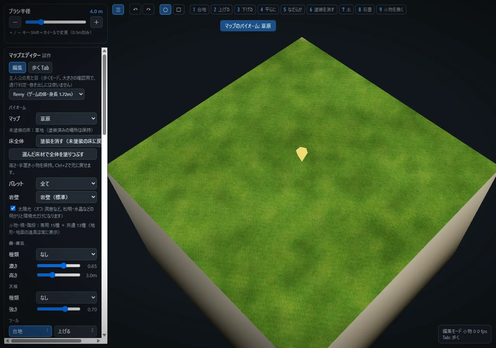

# バイオームの床が前の床のままになる不具合

## 原因と版

公開JSとHTMLは確認時点の `9dd9c14`（Revision 26）に一致した。`e0c3b6a` とRevision 25でも同じ不具合を実UIで再現し、洞窟床変更前 `4451d8e^` では正常だった。

`4451d8e` で同じバイオームの明示的な床指定を保持する処理を加えたが、既存UIが先に `state.biome` を変更する順序を見落とした。結果として、新しいバイオームの選択を「同じバイオームの再適用」と誤認し、直前の床を保持した。荒れ地から草原・海岸などへ切り替えた場合、すべて荒れ地が残ることを15種類の実UIで確認した。

## 修正

- UIでバイオームを選んだ時、そのバイオームの床IDを明示して適用する。塗装配列・高さ・手置き配置を変換しない。
- 地形・地面の道具を小物パレットで非表示にしない。パレットは小物・橋・階段の絞り込みとして表示を説明する。
- 「標準床」を材質名として扱わず、「未塗装の床」と表示。ブラシの `grass` IDは従来どおり塗装消去で、表示を「塗装を消す」にした。専用の草塗装レイヤーを新設したわけではない。
- 読み込んだ明示的な床指定がバイオーム既定と異なる場合、洞窟以外でも保存する。`null` は未指定として旧保存と同じ扱いにする。
- 完成サンプルの整合キーだけ更新。地形・岩・配置・通路・衝突・自動処理と素材画像は変更しない。

## 元の選択肢の監査

バイオーム15種類は変更前から欠落なし：草原、森林、密林、峡谷、荒れ地、山岳、砂漠、洞窟、遺跡、古城、墓地、火山、海岸、雪原、魔界。

地面の選択肢も削除ではなかった。「草」は `343c4ca` で「標準床」へ改名され、バイオーム依存の塗装消去になっていた。土、石畳、砂地、荒れ地、沼地、海岸、溶岩、雪、氷、毒沼の定義は残っていた。初期 `c3eab70` 以来のパレット絞り込みで、森林では石畳・砂地・荒れ地・海岸・溶岩・雪・氷・毒沼が非表示だった。今回それらを全パレットで表示する。高さ、坂、階段、橋、滝、配置、マーカー、通行等も含め、元の道具IDは削除・置換していない。

未塗装の既定：草原／森林／密林=草地、砂漠／海岸=砂地、新規洞窟／墓地=土、遺跡／古城=石畳、雪原=雪、それ以外=荒れ地。

## 検証と既存データ

実UIで15バイオーム切替、全パレットの道具表示、15種類の新規平地、旧保存と未指定／草／土／荒れ地の明示指定25通り、塗装データ一致、未指定バイオーム、undo/redoを確認した。

手動で塗られた荒れ地や土はそのまま残す。既定床の誤保持だけなら、修正版で希望するバイオームを選び直すと未塗装部分が直る。すでに荒れ地を全面塗装したデータは意図的な塗装と区別できないため、自動で消さない。

`baseGround` がない旧洞窟は従来の荒れ地を保持し、新規洞窟は土になる。明示的な `baseGround` 指定も勝手に変換しない。古い洞窟の見た目を一律に土へ変える修正ではない。

草を任意のバイオームへ直接塗り分ける独立レイヤーは、既存の塗装消去とは別の仕様であり、この修正には追加していない。水・波・岩壁・自動生成のアルゴリズムや未公開の小物改修は含めていない。
