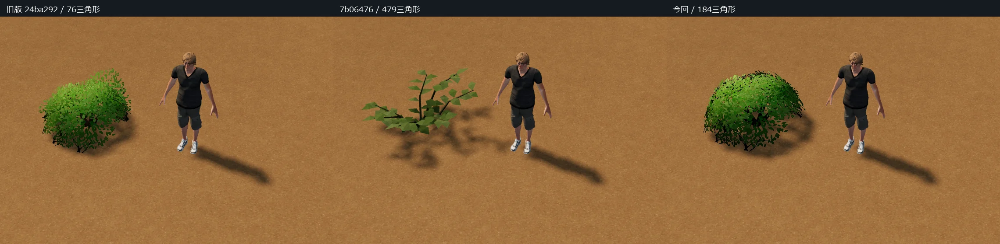
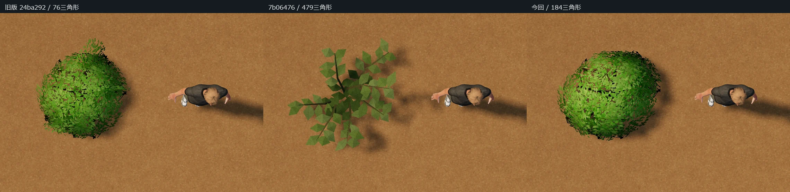
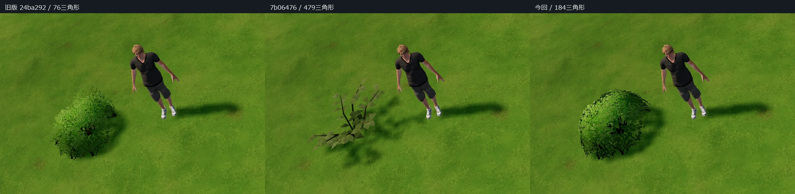
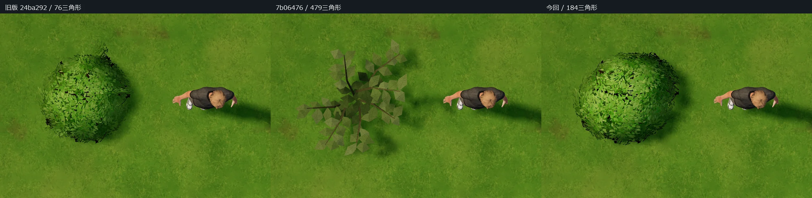

# 旧版を基準にした茂みの磨き込み

7b06476 の茂みは葉を枝沿いに分散したため、旧版の丸く密な木質低木の印象を失っていました。今回は24ba292以前の実レシピを基準に、5本の枝、葉クラスターの配置・色・上下の陰影を継承しました。

18枚分の葉面をそれぞれ2×2に分割してふくらませ、表面に小さな凹凸を持たせています。旧版の十字に交わる面は、同方向の曲面の重なりへ変更。細かな葉の抜きと縁の不規則さは、既存の自作アトラスを使っています。根元の枝から地面へつながる構成とし、設置オフセットは変更していません。

## 同じ条件での3版比較

左：旧版24ba292、中：7b06476、右：今回。ユーザーPCのChrome、同じ縮尺・配置・カメラ・照明・地面です。人物も同じモデルです。歩行角度0.65rad・距離8mと、真上90度・高さ7mの画像から同じ範囲を切り出しました。通常の歩行距離15m、回転・縮尺を変えた4株の群生も別途確認しています。

[比較ページ](../tests/bush_volume_compare.html)から画像を開けます。[実エディタの確認ページ](../tests/bare_soil_view.html?v=bush-volume1)では種類を「茂み」にして土・草・斜面・縮尺を切り替えられます。

旧版の密な丸い輪郭と木質の枝を残し、7b06476の低い草に近いシルエットから戻しています。葉面の曲率と重なり、下側の暗さを加えました。極端に近づくと葉面の繰り返しや、既存アトラスの解像度の限界は残ります。

## 負荷

| 項目 | 旧版 | 7b06476 | 今回 |
|---|---:|---:|---:|
| 三角形/株 | 76 | 479 | 184 |
| 材質/株 | 1 | 1 | 1 |
| 葉の切り抜き | あり | なし | あり（閾値0.42） |

画像アトラス7枚のデータ・サンプラーは完全に同じです。追加画像、追加の描画パスはありません。比較場面の描画呼び出しは3版とも11回、1株の場面全体は101,832→102,235→101,940三角形でした。4株の場面も11回のままです。

今回の頂点は552。位置・法線・色・UV・風/接触重みの静的データは28,704バイト相当で、7b06476の74,724バイトから減っています。配置ごとの既存バッファは据え置きです。

7b06476に対して頂点負荷は減りますが、葉の切り抜きによる重なり・影の描画コストは戻ります。アルファブレンドを追加したものではありません。GPU時間やスマホ実機の比較は行っておらず、三角形削減だけで高速化を保証しません。

## 保存・共有互換

`bush`、`tdj/bush`、カタログ96種の順序、原点、旧配置範囲、選択・配置・削除・回転・縮尺、接地オフセット0.05mを維持。ジオメトリの範囲は幅1.8395m・高さ1.2470m・奥行1.5180mのままです。旧来のカタログ高さ0.93mも互換メタデータとして維持しています。

共有茂みの資産バージョンは2へ更新しました。Unityの更新キットは新v2の切り抜き材質と、7b06476の旧v1（不透明材質）の両方を読み取れます。新v2エクスポートには更新キットが必要です。保存マップのIDやJSON/CSV形式を変えたものではありません。

7b06476の土判定、樹木24種の改善、水、主人公、他の共有49モデルは保全しています。風・接触の設定も7b06476と同じです。

## 検証

- `bush_volume_source.py`の76項目：他49モデルと全画像・土/揺れ処理の完全保全、旧範囲・原点、有限値・単位法線・UV・固定根元を確認。
- 既存の接地ソース回帰1,863項目も通過。選択・配置・45度回転・UI倍率と種類倍率・非均一拡縮・削除・保存再読込、ゴーストと影、新v2カタログを本体で確認。
- 3版×土/草×歩行/真上/通常距離/群生の各8場面。同一条件で実画面を比較し、保存再読込も確認。
- 本体で無風/そよ風/強風、時間の異なる画像、接触方向・連続接触上限・離脱復帰、0.6倍の接触、CPU頂点更新なしを確認。
- 共有GPU検査38モデル。今回の茂みの変位は参照計算との差0.95µm以下、固定根元の差0.42µm以下。位相差、無風の静止基準、変位上限を確認。
- 裸地の36場面＋斜面/境界/大小縮尺/隣接8条件、旧マップ9配置の再読込を通過。茂みの接地位置誤差は1nm未満。
- 隔離Unity 6000.5.9f1/URP/D3D11で16項目＋552頂点の不変検査。新v2の取り込み、旧v1読取、ブラウザとのGPU一致、無風静止、接触と復帰、土/草・真上/歩行・風/接触の20枚を撮影。GPU差0.35µm以下、根元差0。ゲーム本体には組み込んでいません。
- `bake_bush.cjs --check`で再生成一致を確認。

スマホ実機、ゲーム本体統合、Unity Built-inは未検証です。急斜面・大きな非平面、小縮尺の枝下など既存の制限、D3D12終了時クラッシュの未確定事項も継続しています。
