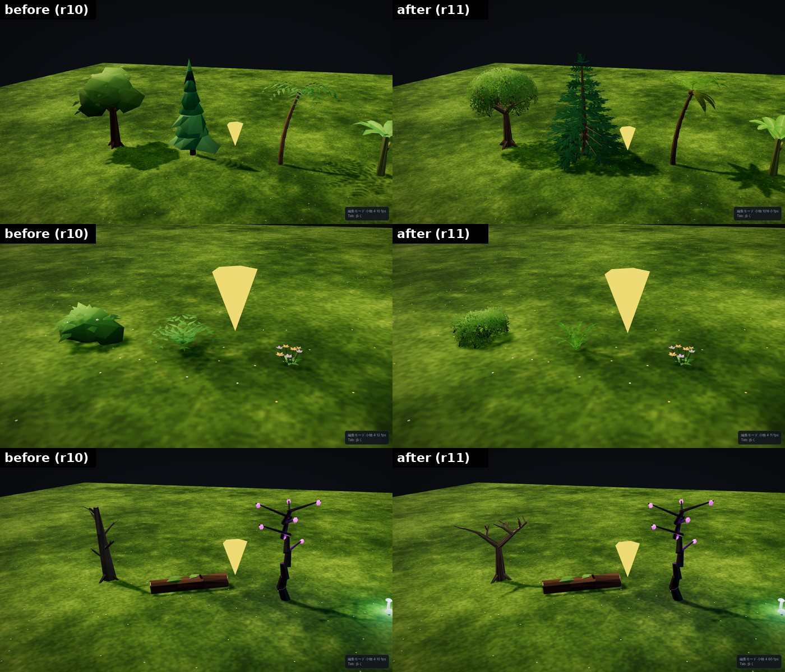
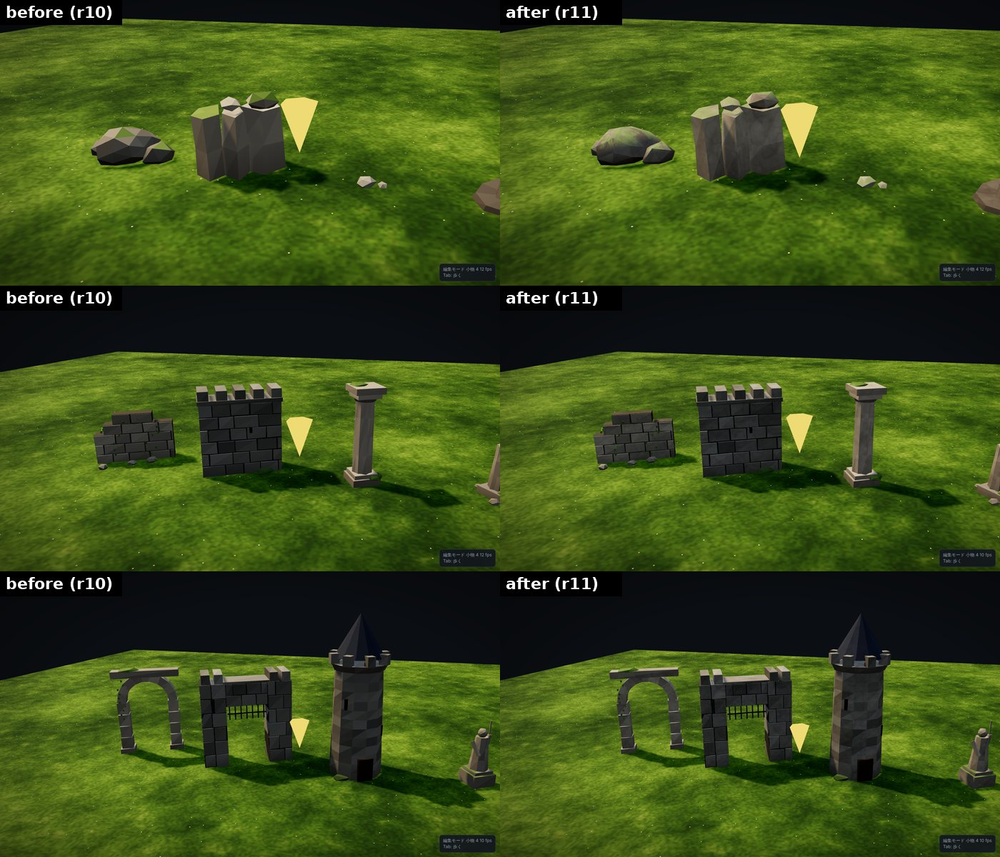
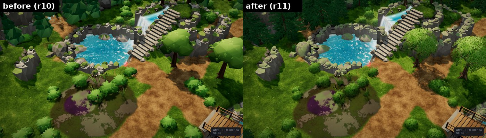

# マップエディター 修正報告（Revision 11）セミリアル化：木・植物・岩

セミリアルな見た目に向けて、木を中心に作り直しました。

- テクスチャは画像ファイルを使わず、起動時に canvas で描きます。リポジトリの容量は増えません。
- 描画の回数は、小物の種類ごとに 1 回のインスタンス描画のままです。
- Unity 向けの書き出しは変わりません（当たり判定の高さは今までの値のまま）。

## 葉のテクスチャ（`props/foliage.js`）

- 1024×1024 の 1 枚に、次のものを描いています。
  - 広葉樹の葉の房（約 300 枚の葉。中は暗く、縁は明るい）と、枯れ色の房
  - 針葉樹の枝（小枝と、前向きに流れる針葉）
  - ヤシの葉・シダの葉（羽状）、バナナの葉（葉脈と裂け目つき）
  - 草の株、樹皮（縦の溝）
- 葉は「カード」に貼って描きます。少ない三角形で葉の細かい輪郭を出す方法で、スマホのゲームの植物で一般的なやり方です。
  - 葉の無い部分はアルファテストで抜きます。並べ替えのいらない不透明の描画なので重くなりにくい方法です。
  - 葉の縁が暗い線にならないよう、抜く部分の色を葉の平均色で埋めています。
- 木漏れ日のように、葉の形の影が地面に落ちます。

## 木・植物

| 小物 | 作り | 三角形（前 → 後） |
|---|---|---|
| 広葉樹 | 幹 → 太枝 5 本 → 小枝 15 本と枝分かれし、枝先と樹冠の殻に、外を向いた葉の房のカードを 37 枚、中の隙間を埋める十字のカードを 4 組。中ほど暗く、上ほど明るい | 576 → 346 |
| 針葉樹 | まっすぐな幹に 12 段の輪生枝。枝ごとに針葉のカード（1 段おきに斜めのカードを足す）。下の段の枝は木で見える。色は青みのある暗い緑 | 276 → 314 |
| ヤシ | 節のある幹。羽状の葉を 13 枚（曲げた帯）。古い葉は垂れて枯れ色 | 676 → 556 |
| バナナの木 | 裂け目のある大きな葉 7 枚 | 318 → 262 |
| 茂み | 細い枝と、葉の房のカード 15 枚（中心の 3 枚は十字） | 300 → 76 |
| シダ | 弓なりの羽状の葉 11 枚 | 468 → 220 |
| 枯れ木 | 3 段に枝分かれする節くれだった枝と根。樹皮のテクスチャ | 176 → 212 |
| 葦 | 足元に草の株を追加 | 396 → 404 |

- 樹冠のカードは、法線を樹冠の外向きにそろえています。そのため、木全体がひとかたまりの柔らかい陰影になります。
- カードは表も裏も同じ明るさで照らします。
- 葉のカードの陰影は Lambert（拡散光だけ）にしました。葉には鏡面反射が要らず、アルファテストのカードは覆った画素をすべて計算するので、軽い計算方式が効きます。

## 岩・崖石・石の建物

- 岩肌の細部用のテクスチャ（`props/detail.js`、256×256、継ぎ目なし）を足しました。
  - 3 方向から世界座標で投影します（UV の準備が要りません）。
  - 細かい粒・くぼみ・ひびが、大小 2 つの大きさで重なります。
  - 隣どうしの岩で同じ模様がくり返しません。
- 対象：
  - 岩・崖石・小石
  - 壁・城壁・城門・塔・石柱・アーチ門・石像・石碑・墓・霊廟・石筍・溶岩岩・オベリスク・ピラミッド・灯台など（`material: 'stone'`）
- 岩・崖石・小石は、なめらかな陰影にしました。50° より鋭い稜線は残しています。
- 苔の付き方を変えました。
  - 前：上を向いた面をまるごと緑にしていた。
  - 後：上向きの面に、テクスチャの模様にそった斑で苔が付く。
  - 苔の色は、岩壁の種類の色（例：砂漠なら砂の色）、なければバイオームの色、どちらもなければ緑です。

## 軽さ

- 増えたテクスチャは 2 枚です。1024×1024 の葉（約 5.6MB、ミップマップ込み）と、256×256 の岩肌です。
- 描画の回数は変わりません。材質（シェーダー）は 3 種類増えました（葉のカード・石積み・岩）。
- 部屋全体の三角形の数：サンプル1 176,638 → 155,116（−12.2%）、サンプル2 66,608 → 61,360（−7.9%）。
- 画素の計算は増えました。
  - 測り方：サンプル1を 1280×720 で描く時間を、GPU を使わないソフトウェア描画（SwiftShader）で測りました。画素の計算量の目安です。
  - 結果：全体を見下ろす視点で約 1,600ms → 約 2,900ms（約 1.8 倍）。
  - 内訳：大半は葉のカードです。葉の無い部分を抜くカードは、重なった分もすべて計算されます。
  - 抑えるためにしたこと：
    - 十字のカードをやめて、外を向いた 1 枚のカードにした（重なりを減らす）
    - 異方性フィルタを 2 にした
    - 葉の陰影を Lambert にした
  - 実機の GPU では差がもっと小さくなるはずです。ただし、この環境では実機の GPU で測れていません。
- エディターの小物の形は、画面に出すためだけのものです。Unity には形を書き出しません。Unity の見た目と重さは、Unity 側の Prefab で決まります。

## 確認結果

- 書き出し：2 つのサンプルで、全ファイルが前の版と同じでした。違うのは manifest.json の書き出し時刻だけで、contentHash も一致しました。
- 既存のテスト：次をすべて通過しました。
  - 受け入れテスト（Revision 3・4・5、隠し通路サンプル）
  - 既存機能のテスト 13 本
  - 水の書き出しテスト
  - 前の版との差は、毎回変わる値（部屋の ID、「崖に岩を自動配置」の個数）だけでした。
- 岩壁の 7 種類（標準・土・黒・濡れ・苔・砂漠・雪）は、どれも見分けられる見た目のままです。
- 画面のエラー：0 件。

