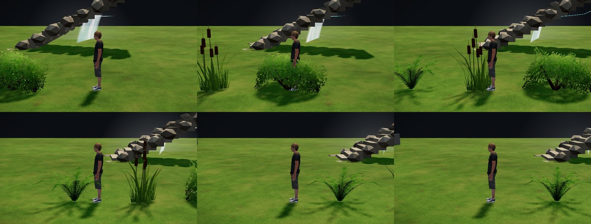

# マップエディター 修正報告（Revision 14）植物の揺れ

歩くモードで主人公が茂み・草に触れたとき、植物が押しのけられて傾き、離れると揺れながら元に戻るようにしました。

- 見た目だけです。通行判定・保存データ・Unity 向けの書き出しは変わりません。
- 対象は、通り抜けられる低い植物です：茂み（`bush`）、シダ（`fern`）、葦（`reed`、足元の草の株を含む）、花（`flowers`）。
- 小物のファイルの `touch: true` で対象を決めます（`props/README.md`）。ほかの小物にも、この 1 行で付けられます。

## 動き

- 植物 1 本ずつを、減衰するばねとして計算します。
  - 主人公の体（半径は通行判定の `state.agent.radius`）が植物の広がりに重なると、重なった分だけ、植物の上の方が主人公から離れる向きへ押されます。
  - 歩いている間は、進む向きへも少し引きずられます。
  - 主人公が離れると、ばねで元に戻ります。少し行き過ぎて、何回か揺れてから止まります（1 秒に約 1.3 往復、約 1.5 秒で収まる）。
- 傾きの大きさは、植物の高さの 38%（最大 0.45m）までです。根元は動かず、上へ行くほど大きく曲がります。
- 触れている植物と、揺れが収まっていない植物だけを計算します。止まった植物は計算の対象から外します。
- 編集モードに戻ると、すべて元の形に戻ります。

## 作り

- `app.js`：
  - `updateTouch()`：ばねの計算です。毎コマ、触れている植物だけを更新します。
  - 植物ごとの曲がりは、インスタンスごとの値（`touch` 属性：上端の曲がり x・z と、形の高さの逆数）で GPU に渡します。頂点は GPU の頂点シェーダーで曲げます。CPU で全頂点を書き換えることはしません。
  - 材質は、揺れる種類だけ、揺れの処理を足した版（`touchMat`）を使います。描画の回数は増えません。
- シダは共有小物（`props/shared/`、Unity と同じ形・画像・材質値）です。
  - 共有の形・画像・材質値は変えていません。エディターの画面で揺れの処理を足しただけです。
  - Unity 側の揺れは入れていません。ゲームでも揺らす場合は、Unity 側のシェーダーに同じ曲げ方を足す必要があります。
- 影は揺れません。影は止まったままの形で落ちます。

## 確認結果

- `PW=<playwright> node tests/touch_sway.js`：9 項目すべて合格。
  - 揺れる種類：茂み・シダ・葦・花（岩は揺れない）
  - 茂みを通り抜けると、最大 0.41m 傾く
  - 離れた後、向きが 3 回反転しながら戻り、4 秒以内に止まる
  - 触れていない植物は動かない
  - 編集モードでは元の形
  - 地図データは変わらない
  - ページのエラー 0
- 書き出し：2 つのサンプルで、全ファイルが変更前と同じでした。違うのは manifest.json の書き出し時刻だけで、contentHash も一致しました。
- 既存のテスト：次の結果は、どれも変更前の main と同じでした。
  - 受け入れテスト（Revision 3・4・5、隠し通路サンプル）と既存機能のテスト 13 本：すべて通過
  - 主人公のテスト（`tests/hero_view.js`）：35 項目中 34 項目が合格
    - 不合格は「切り替え 5→2.5m/秒」の 1 項目です。変更前の main（`47ec28b`）でも、この環境ではほぼ同じ値で不合格でした（つま先 0.203m、基準 0.18m の 1.1 倍を超える）。
    - 今回の変更は主人公の動きに触れていません。
