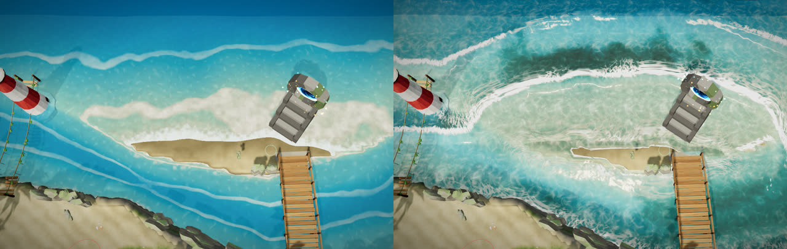
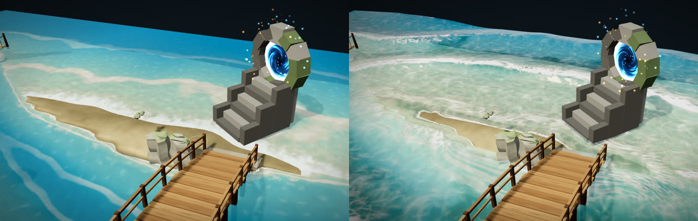
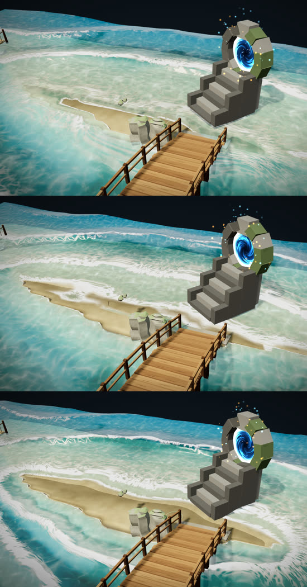
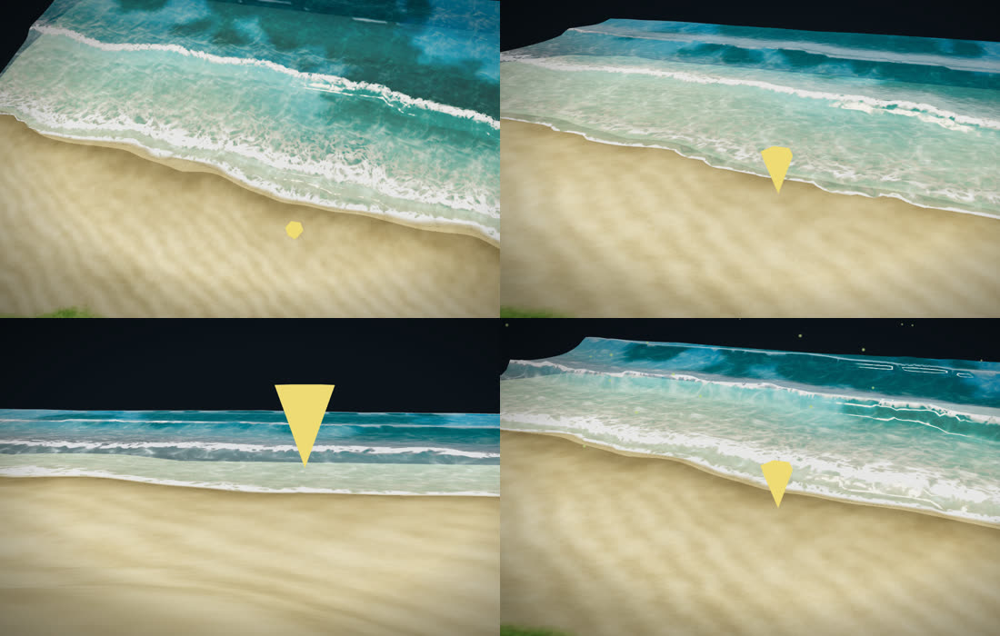

# マップエディター 修正報告（Revision 18）海と海岸

「波に見えない」という指摘を受けて、海と海岸の描き方を作り直しました。目標は、ユーザーが参考に挙げた動画の 2 つ目の海です。

- 浅瀬の海底に、光の網目（コースティクス）が強く揺れる。
- 水が澄んでいて、海底が透ける。
- 浅い所はエメラルド、沖は濃い青。
- 細かいさざ波と、太陽のきらめきがある。
- 砂浜の際に、泡と濡れた砂がある。

湖・川・滝つぼは、今までどおりの描き方です。

## どこが「海」か

- 地図の端につながっている水を「海」とします。囲まれた池や湖は海にしないので、静かなままです。
- 海の水際から内陸へ約 4m までの砂浜も、海に含めます。波が打ち上がる所だからです。
- 海の描き方を使うのは、次のどちらかのときです。
  - 「海岸」ツールで海を作ったとき
  - バイオームが「浜辺・磯」のとき
- 地形を変えるたびに、水面の頂点ごとに次の 3 つを計算し直します（`computeShoreField`）。
  - 水際までの距離（海側が＋、陸側が−、単位は m）
  - 岸への向き
  - 海かどうか

## 波

- 波の山は、水際までの距離に沿って、岸へ向かって進みます。
  - 波長は 7.5m、周期は 4.4 秒です。
  - 山の線は、岸に沿って少し曲がります。
  - 山ごとに高さが違い、同じ山の中でも場所によって高さが変わります。
- 水面そのものを上下に動かしています。頂点は 0.5m おきです。
- 浅くなるにつれて、波は高く、前の面が急になっていきます（水深 3.2m から）。
- 水深 1.5〜0.75m で波が崩れ、その後は低くなって岸へ進みます。
- **打ち上がり**：崩れた波は、水際を越えて砂浜を駆け上がり、遅れながら上って、また引いていきます。
  - そのため、波打ち際の位置そのものが動きます。
  - 届くのは水際から数 m までです（高さ × e^(−距離/1.4m)）。
  - 浜の奥のくぼみに、水が溜まって見えることはありません。
- 天候の風に合わせて、波が高くなります。
  - 風なし：0.38m
  - 強風：0.77m
- 上から見ても波の列がわかるように、陰影を付けています。日の当たる側の波の面は明るく、裏側は暗くなります。

## 泡

- **白い波頭**：浅くなって前の面が急になった波の山に出ます。
- **砕けた後の白い水**：崩れた波の山の、沖の側に残って薄れていきます。
- **打ち上がりの縁**：波打ち際の薄い水に、白い線が出ます。
- **沖の筋**：沖に、薄い泡の筋が少しだけ出ます。
- 泡の模様は、大きさの違う 2 つの穴あき模様（ボロノイ）をゆがめて重ね、レース状にしています。模様は、波と一緒に岸の方へ流れます。

## 水の色・海底・光

- 水深によって、色と透け方が変わります。
  - 色：浅い所はエメラルド、深い所はバイオームの深い色へ。
  - 透け方：浅い所は 34%、深い所は 96% の不透明度。浅い所ほど、海底の砂が見えます。
- **光の網目（コースティクス）**：大きさと速さの違う 2 枚を重ね、ゆがめて、繰り返しが見えないようにしています。浅い所ほど強く出ます。
- **海草・岩の斑点**：水深 0.5〜7m の海底に、暗い斑点を描きます。
- **水面**：波の傾きに、2 つの大きさのさざ波を足しています。
  - 太陽のきらめき（鋭い光と、ちらちら光る粒）
  - 斜めから見たときの空の映り込み
- **濡れた砂**：打ち上がりの届く高さまでの砂は、少し暗くなります。引いた直後の所には、薄い光沢が出ます。

## 平らな地図に海岸ツールで作った場合

上から・斜めから・目の高さから・強風のとき：

## 書き出し

- 海のあるとき、`meta.json` の `water[0].waves` に、Unity で同じ波を作るための数値を入れます。
  - 波長・周期・高さ
  - 波が急になり始める深さ・崩れる深さ
  - 打ち上がりの高さと届く距離
- 見た目だけの変更です。通れる所・`water.png`・水の流れの解析は変わりません。
- Unity でも同じ海を作れるようにしました。`sea_field.png`・`meta.sea`・`MapWater/Sea` については、Revision 19 の報告書（`docs/REVISION_19_NOTES.md`）を見てください。

## 確認

- `tests/sea_waves.js`（新規）：8 項目
  - 沖は海で、向きは岸の方
  - 浜は陸で、水際から数 m は海に含める
  - 浜の奥は海に含めない
  - 内陸の池は海ではない
  - 波が動く（2.2 秒で波打ち際の絵が変わる）
  - 強風で波が高くなり、書き出しに波の数値が入る
  - 海の無い地図では、何も変わらない
  - ページのエラー 0
- 森のサンプルの川と滝つぼの見た目は、変更前と同じです。

- 全体の回帰テスト：ユーザーの版 31319eb（Revision 18・19 の前）と、今の版で同じ一式を流して比べました。
  - 私の変更で新しく失敗したものはありません。
  - 両方の版で失敗するもの（9 本）：walktest・secret・bridgetest・v5test・reviewtest・rev3_acceptance・rev5_terrain_grid・touch_sway・water_export。
    - water_export 以外は、すべて「崖の岩を調整中です。完了後に保存してください」で止まります。31319eb までに入った崖の岩の位置合わせ（終わるまで保存・書き出しできない）の後、テストが位置合わせの終わりを待たずに保存しているためです。
    - water_export は、テストの道具 tests/cdp.js が、ページの読み込み直しを想定外として止めています。
  - linkui は 31319eb で失敗、今の版で合格。
  - それ以外は両方で合格です。今回の新しいテストも合格しました（sea_waves・sea_hlsl_sync・editor_ui・map_name_light・secret_climb・water_unit）。
