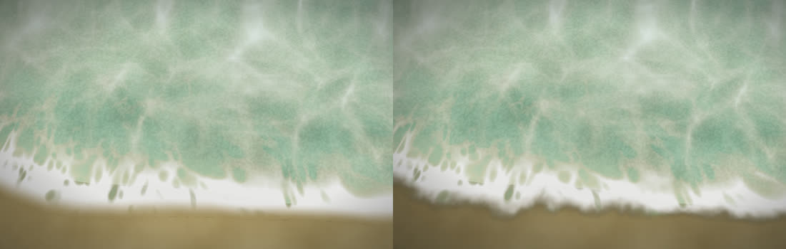
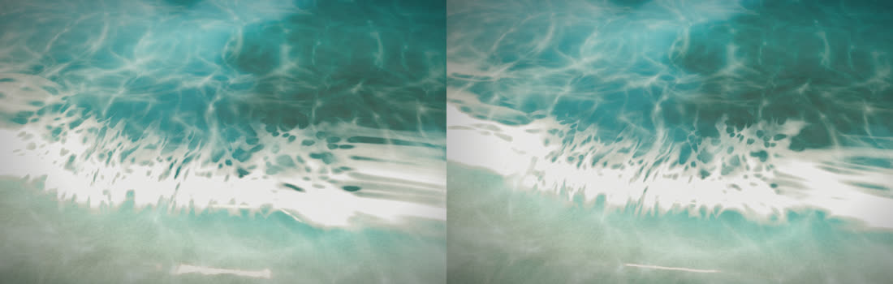

# マップエディター 修正報告（Revision 20）海の境界をなめらかに

ユーザーの指摘：「海が一部カクついている。動作が重いのではなく、境界などがなめらかではない」。

Unity も同じ式（`sea.js` から作る `MapSeaShared.hlsl`）・同じ場（`sea_field.png`）・ほぼ同じ細かさの格子なので、同じようにカクついていました。今回の修正は、`sea.js` と書き出しの場を直したので、エディターと Unity の両方に効きます。

## 原因と直したこと

1. **波の山の線が折れ曲がる**
   - 原因：水際までの距離を、8 方向だけを見る近似（チャンファー距離）で計算していました。この近似では、距離の等高線が多角形になります。波の山はこの等高線に沿って並ぶので、山の線が角ばっていました。
   - 直したこと：正確なユークリッド距離（行と列で 2 回、二乗距離変換をする方法）にしました。そのうえで、水際の格子の段差だけを軽くならしています。
2. **波の陰影・泡・水際が三角形で区切られる**
   - 原因：波の高さ・傾き・位相を、0.5m の格子点でだけ計算し、そのあいだは直線でつないでいました。そのため、波の面の明暗や白い波頭に、三角形の継ぎ目が出ていました。
   - 直したこと：`seaWave`（高さ・位相・崩れ・傾きをまとめて返す関数。`sea.js`）を、頂点でも画素でも呼ぶようにしました。
     - 頂点：メッシュを上下させる。
     - 画素：陰影・泡・波頭と、水が届いているかどうかを、画素ごとの値で決める。
   - そのため、水際（打ち上がりの先）も、画素ごとの曲線になりました。
3. **水際に、角ばった暗い線が出る**
   - 原因：濡れた砂は、水面の板に描いています。陸の上ではその板が「静水の水位 + 波の高さ」にあり、それより高い砂の下に潜っていました。そのため、濡れた砂の見える範囲が、板が砂に潜る線（地形の三角形の形）で切れていました。
   - 直したこと：
     - 陸の上では、板を砂の 2cm 上に置き、砂に沿わせました。
     - 水際では、水と濡れた砂の色・不透明度をそろえて、なめらかにつなぎました。
     - 濡れた砂は、水際から少しずつ暗くなるようにし、暗さも弱めました。
     - 水際のすぐ近くだけ、水面の高さに細かいゆらぎ（±1.75cm）を足しました。水際の線が、地形の直線ではなく、不規則なレース状になります。
     - 海の重みが 0 になる手前で、濡れた砂を消します。板が砂に潜る所の細い三角形が見えないようにするためです。

## Unity

- `MapSeaShared.hlsl` は、直した `sea.js` から作り直しました。
- `MapSea.shader` も、エディターと同じ形に直しました。
  - 頂点では `seaWave` で上下させ、陸の上では砂の上に置く。
  - 画素でも `seaWave` を計算し直して、その水深で水際を決める。
- 頂点から画素へ渡す値は、海の重み・水際までの距離・静水の水深・波の高さ・岸への向きだけになりました。
- 今回も、Unity でのコンパイル・実行は、この環境ではしていません。

## 確認

- 同じ時刻・同じ視点の画像で、修正前と後を比べました（上の 2 枚）。
- いつもの視点（島のサンプル・海岸ツールの海岸・目の高さ）でも撮影して、崩れが無いことを確かめました。
- `tests/sea_waves.js`：9 項目すべて合格。書き出しの `sea_field.png` を Unity と同じ読み方で読むと、エディターの場と一致します。
- `tests/sea_hlsl_sync.cjs`：13 項目すべて合格。Unity の shader が、頂点と画素の両方で `seaWave` を呼ぶことも見ています。

## 残っていること

- 地形そのものも 0.5m の三角形なので、とても近くで真上から見ると、浜の傾きの変わり目にわずかな折れ目が残ります。今回は、ゆらぎと色のつなぎで目立たなくしています。
