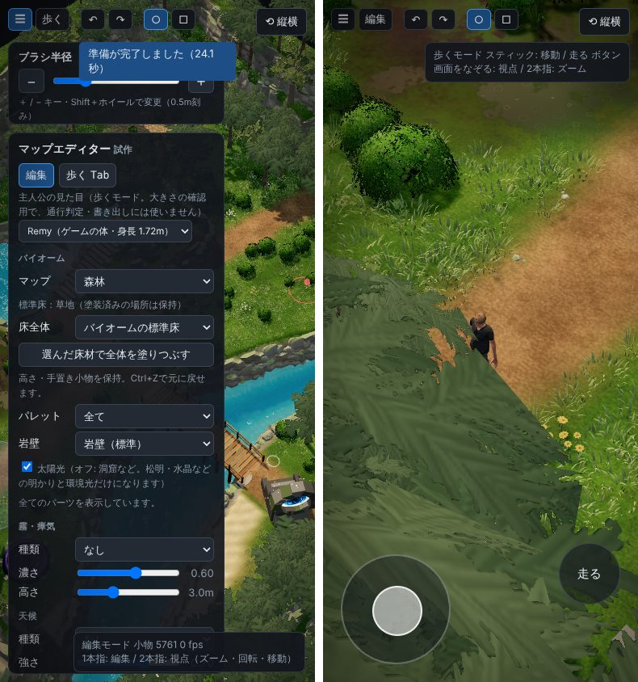
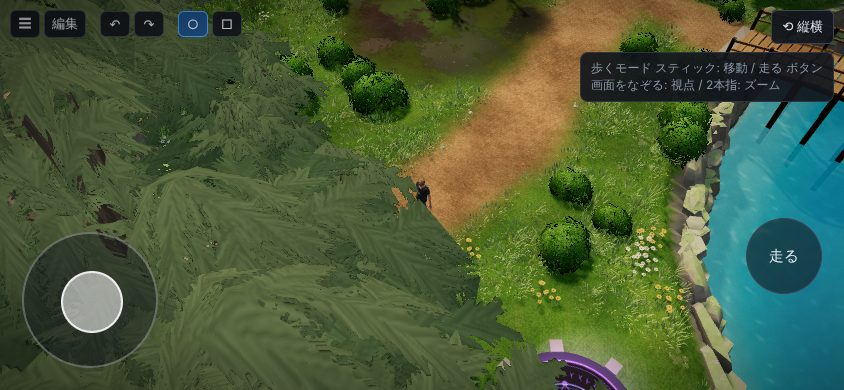

# マップエディター 修正報告（Revision 21）スマホでマップを歩く

ユーザーの依頼：「スマホでマップを歩けるようにしたい。左のメニューを出し入れ可能に。移動用のボタン（パッド）のような仕組み。スマホのみ、右上辺りに縦横切り替えのボタン。PC では不要。」

## タッチの端末だけに出すもの

タッチの端末かどうかは、主な指し方が指であること（`pointer: coarse`、またはタッチがあってマウスのホバーが無い）で決めます。PC では、次の物は出ません（`☰` だけは PC にも出ます）。

- **`歩く`／`編集`**（上のバー）：モードの切り替え。PC の `Tab` と同じです。
- **移動のスティック**（歩くモードの左下）
  - 指で倒した向きに歩きます。上が前（カメラの向き）です。
  - 倒す量で速さが変わります。半分倒すと半分の速さです。
  - 指を離すと止まります。
- **走るボタン**（歩くモードの右下）：押すたびに、走る・歩くが切り替わります。走る速さは、PC の `Shift` と同じ（毎秒 8m）です。
- **`⟲ 縦横`**（右上）：画面の縦と横を切り替えます。
  - Android の Chrome など、画面の向きを固定できるブラウザでは、全画面にして向きを固定します。もう一度押すと、固定を外して全画面を終えます。
  - iPhone の Safari のように固定できないブラウザ、または 1.5 秒待っても向きが変わらないときは、ページそのものを 90° 回して表示します。スマホを左に倒して横向きで持ってください。もう一度押すと元に戻ります。
  - 回した表示でも、指で触った所・スティックの向きは、見たとおりに効きます。
- 1〜9 のスロットのボタンは、タッチの端末では隠しています（キーボードが無く、場所を取るため）。

## 左のメニューの出し入れ（PC も）

- 上のバーの左端の `☰` で、左のメニュー（ブラシ半径の欄も）をしまう・出す。
- しまうと、上のバーは左に寄り、地図は画面の真ん中に描かれます。
- 開け閉めの状態は、このブラウザに保存されます。最初は、PC は開いた状態、タッチの端末は閉じた状態です。

## 指の操作

- **歩くモード**
  - 1 本指で画面をなぞる：視点が回る。
  - 2 本指を開く・閉じる：ズーム。
- **編集モード**
  - 1 本指：編集。
    - 置いてから少し（0.12 秒）たってから始まります。そのあいだに 2 本目の指が来たら、編集はせずに視点の操作になります。
    - さっと触って離したときも、1 回分の編集（置く・選ぶ・塗る）をします。
  - 2 本指：開く・閉じるでズーム、ひねると回転、そろえて動かすと視点の移動。

## PC の操作

マウスの操作は、これまでどおりです。

- 左ドラッグ：編集（歩くモードでも）
- 右ドラッグ：視点の回転
- 中ドラッグ：視点の移動
- ホイール：ズーム

## 確認

- `tests/mobile_walk.js`（新規、15 項目すべて合格）
  - PC の画面（1300×800）
    - タッチ用のボタン・スティックが出ない。
    - `☰` でメニューをしまう・出す。
  - スマホの画面（390×844、タッチ）
    - メニューは閉じて始まる。
    - 縦横ボタンが右上にあり、上のボタン列と重ならない。
    - スティックを上へ倒すと前へ毎秒 5m で歩き、離すと止まる。少し倒すと遅い。走るボタンで毎秒 8m。
    - 画面をなぞると視点が回る。
    - 縦横ボタンでページが 90° 回り、描く大きさ（844×390）とカメラの縦横比も入れ替わる。回したあとも、スティックの上が前になる。もう一度押すと元に戻る。
    - 編集モードで、指を置いたままにすると地面が上がる。2 本指はズームだけで、地面は変わらない。
  - スティックと指は、Chrome の開発用の機能（CDP）で、本物のタッチの入力として送っています。
- 既存のテスト `tests/editor_ui.js`（11 項目）・`tests/map_name_light.js`（12 項目）も合格です。
- マウスの右ドラッグ・中ドラッグ・ホイールで視点が動き、地形が変わらないことも確かめました。

## 確認していないこと

- 実機（iPhone・Android）では試していません。この作業の環境では、Chromium の画面の大きさとタッチを、スマホに似せて動かしています。
- 画面の向きの固定は、Chromium のテスト用の環境では効きません。そのため、テストでは「ページを 90° 回す」ほうの動きを確かめています。Android の Chrome での固定は、実機で確かめてください。
- スマホでの描画の重さは測っていません。重いときは、天候や水の表示を切ると軽くなります。
