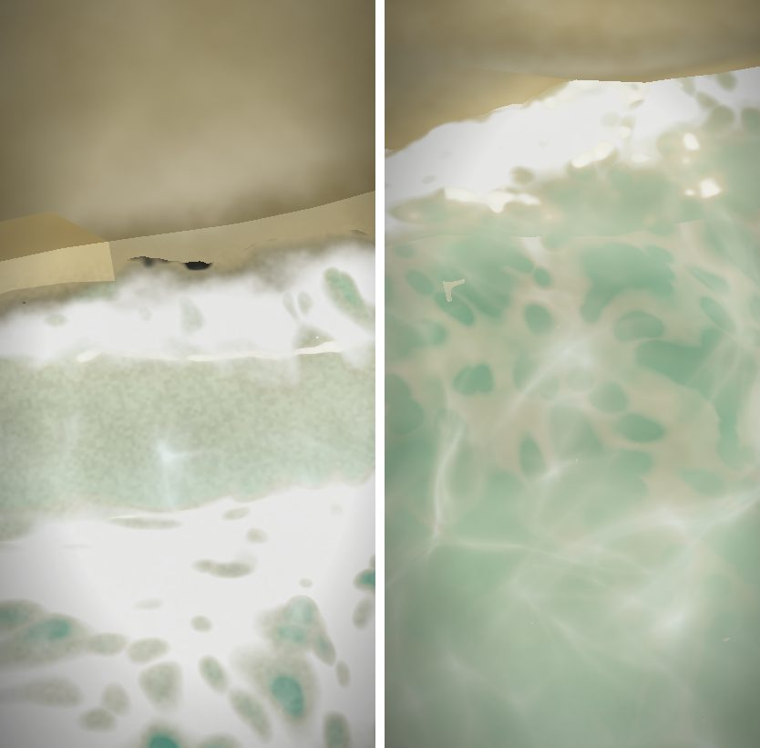
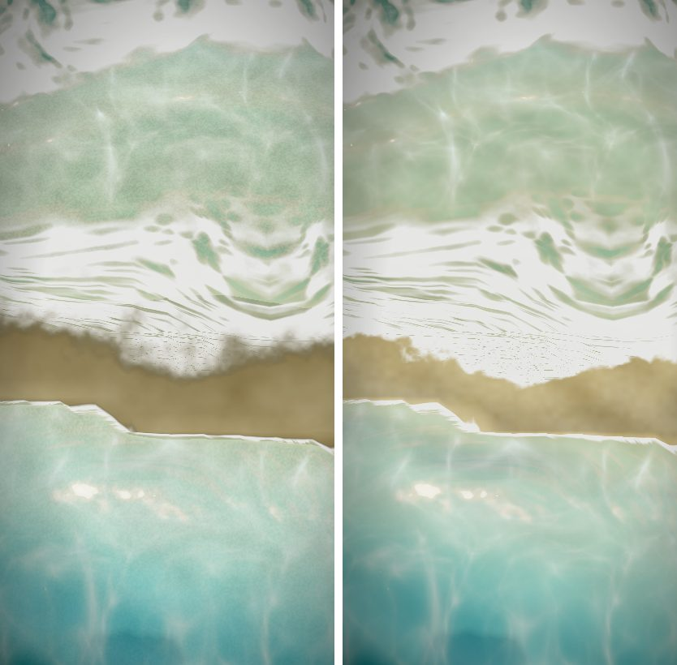

# マップエディター 修正報告（Revision 22）海岸の境目と、水際の黒い影

ユーザーの指摘（スマホで海岸を見て）：

- 陸の砂地と、海の中の砂地の色の差が強く、境界がくっきりしていておかしい。
- 波の部分に、謎の黒い影がある。

## 調べてわかったこと

送ってもらった画面と同じ向き（海の側から、低めの角度で陸を見る）で、PC でも同じ症状が出ました。スマホだけの問題ではありませんでした。

1. **砂の色が水面の高さで切り替わっていた**（地形のシェーダー）
   - 水面より少し上（18cm まで）の砂だけを 0.72 倍に暗くし、水面より下は暗くしていませんでした。
   - 水面より下は、海底の別の色（陸の砂より明るい）に、水深 6cm で切り替えていました。
   - 波が引くと、この「明るい海底」が出てきます。その縁は、静かな水面の高さの線、つまり地形の三角形の形でくっきり見えていました。
2. **水面の板の作る濡れた砂が、多角形に切れていた**
   - 波が濡らす砂（打ち上がりの届く高さまで）は、水面の板が陸の上で暗い色を重ねて描いていました。
   - 板は海の重み（地図の端につながる水と、その浜）がある所にしか無いので、平らで低い浜ではその端が三角形の形で切れていました。切れた所だけ明るい砂が見え、四角い板のように見えていました。
   - 陸の上の板は、砂の 2cm 上に置いています。スマホは奥行きの精度が PC より粗いため、遠くでは板と砂が格子ごとに前後して、菱形の模様に見えていたと考えられます（実機では確かめていません）。
3. **黒い影は、水際の色の混ぜ方のせい**
   - 水がごく薄い所（深さ 3cm まで）では、水の色を「濡れた砂の暗い色」へ混ぜていました。
   - 色と不透明度を別々に混ぜていたため、泡が濃い所では、暗い色のまま不透明になり、ほぼ黒の斑点になっていました。

## 直したこと

- **地形のシェーダー**（`app.js`）
  - 水際の濡れた砂の暗さを、地形のほうで描くようにしました。静かな水面をまたいで、水の中まで続けて暗くします。海では、打ち上がりの届く高さ（50cm）まで暗くなります。
  - 水の中の砂は、浜の砂と同じ色のまま、深さ 60cm までかけて少しずつ海底の色へ移ります。
  - 地面を「砂地」で塗った所は、その砂の色のまま水際まで続けます。これまでは、水際だけ別の色の砂に置き換わっていました。
- **海の式**（`sea.js`）
  - 水際では、水の色は変えずに、不透明度だけを 0 へ下げます。水は、その下の濡れた砂へ透けて消えます。泡のレースだけは、水際まで残します。
  - 水面の板は、陸の上では、打ち上がった波が引いた直後の濡れた砂（つやのある帯）だけを描きます。それ以外の所は描きません（画素を捨てます）。
  - そのため、浜の上の板が砂と重なってちらつくことも、板の端が見えることもなくなります。

## Unity

- `MapSeaShared.hlsl` を作り直しました。水際の消え方（不透明度だけを下げる）は、エディターと同じになります。
- Unity の地形は、波が濡らす砂を暗くしません。そのため Unity では、これまでどおり水面の板が濡れた砂を描きます（`SEA_SOAKED` を 1 にしています。エディターは 0）。
- 今回も、Unity でのコンパイル・実行はしていません。

## 確認

- `tests/sea_shore_seam.js`（新規）：修正前は 3 項目とも失敗し、修正後はすべて合格。
  - 水を隠して、水際をまたいで砂の明るさを見たとき、段が無いこと（6 画素での変化：修正前 0.157 → 修正後 0.036）
  - 海の側から低い角度で、波の 6 つの瞬間に、水際にほぼ黒の画素が無いこと（修正前は最大 294 画素）
  - 波の届かない浜（水際から 2.8〜4.7m）で、水面の板が何も描かないこと（明るさの差：修正前 0.059 → 修正後 0）
- `tests/sea_waves.js`（9 項目）・`tests/sea_hlsl_sync.cjs`（13 項目）も合格。
- 森のサンプルの川（海ではない水）も、前後で見た目がほとんど変わらないことを確かめました。

## 確認していないこと

- スマホの実機では試していません。菱形の模様は、上の 2. の理由（板と砂の重なり）だと考えて直しました。直っていなければ、機種とブラウザを教えてください。
