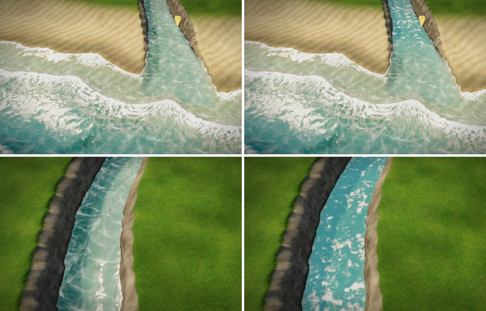
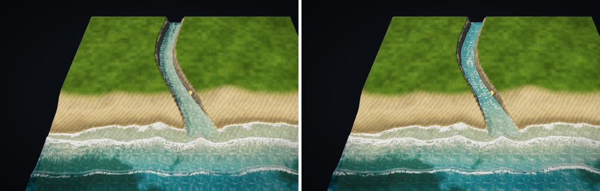

# マップエディター 修正報告（Revision 23）海につながる川

ユーザーの指摘：「川を作ろうと思ったら細い海になっちゃった。ちゃんと川にできる？」

## 原因

- 海は「地図の端につながる水」すべてにしていました。
- 地図の端から海まで水路を掘ると、水路も地図の端につながるので、全部が海になっていました。水路にも岸へ寄せる波・砕け波・打ち上がりが出ていました。

## 直したこと

- **海の決め方**（`app.js` の `computeShoreField`）
  - 海は、陸から 4m 以上離れた「開けた水」で、地図の端につながる所から広がります。地図の端は陸として数えません。
  - 海は、そこから 4m までの水に広がります。そのため、浜の波打ち際は、これまでどおり海です。
  - 幅がおよそ 8m より細い水路は、地図の端や海につながっていても川になります。
  - 河口では、6m かけて海から川へ混ぜます。境目で波がぷつりと切れません。
- **川の流れ**（`water.js`）
  - これまでどおり、地図の端から端へつながる水は川として流れます。今回の水路は、地図の端（上流）から海（下流）へ流れます。
  - 流れの速さは「水の所の速さの 95% 点が毎秒 1.2m」になるよう合わせています。これまでは海の水も数えていました。広い海は流れが遅いので、川の部分が上限（毎秒 2m）に張り付き、早瀬の泡ばかりになっていました。今は、開けた海を除いて合わせます。
  - 川が浅い（0.8m より浅い）所は、これまでどおり早瀬の白い泡が出ます。深く掘ると落ち着いた川になります。
- **書き出し**
  - これまで、海のある地図では、川・池の流れの画像（`water_flow.png` / `water_mask.png`）を出していませんでした。
  - 今は、海のほかに川・池があれば出します（`meta.waterSim.available = true`）。海だけの地図では、これまでどおり出しません（理由は `sea only: …`）。
  - `sea_field.png` の A（海の重み）は、川では 0、河口では 0 から 1 へ変わります。

## Unity

- `MapWaterBuilder.Build`：海のある地図で、川・池の流れの画像もあれば、両方を作ります。
  - `MapWater_<名前>`：海（`Sea`）
  - その下の `Rivers`：これまでの池・川の水面（滝・飛沫もここ）
- `MapWater/Water`（`MapWater.shader`）に `_SeaTex` を足しました。
  - `sea_field.png` を渡すと、その A（海の重み）の分だけ水面を透明にします。
  - そのため、川の水面は海の所では消え、海と重なりません。河口では、エディターと同じく海へ受け渡します。
  - `_SeaTex` を渡さないとき（海の無い地図）は、黒（重み 0）なので、これまでと同じです。
- 今回も、Unity でのコンパイル・実行はしていません（この環境には Unity も C# のコンパイラもありません）。

## 完成サンプルの作り直し（おわび）

- 既定のサンプル（64m）と、サンプル2（48m）は、作り終えた状態を `prepared/` に入れて配っています（`docs/PREPARED_SAMPLES.md`）。
- その照合の鍵には、`index.html` のスクリプトの版の文字列が入っています。そのため、`app.js` などを変えたら、`node tools/build-prepared-samples.cjs` で作り直す必要があります。
- Revision 22 で、私は版の文字列を変えたのに、作り直していませんでした。そのため、公開中の版で既定のサンプルを開くと、「準備失敗: 完成サンプルと現在の生成条件が一致しません」と出て、小物の無い地図になっていました。
- 今回、作り直して `--check` を通しました。
  - この作業の環境（画面の無い Chrome）では、窓が裏にある扱いになってタイマーが間引かれ、ツールが 120 秒で止まりました。ツールそのものは変えず、作業用の写しで、タイマーを間引かない起動オプションを足して実行しました。生成されるデータは同じです。
  - 古い 2 つのファイルは消し、新しい 2 つと `manifest.js` に差し替えました。
  - 既定のサンプルが、エラー無しで開けることを確かめました（小物 5761 個）。

## 確認

- `tests/sea_river.js`（新規、7 項目すべて合格）
  - 幅およそ 3.5m の水路を、地図の北の端から南の海まで掘りました。
  - 水路（河口より上流）の海の重みは 0。沖は 1。
  - 河口では 1m あたりの変化が 0.18（なめらか）。
  - 川は北の端から海へ、毎秒 1.0〜1.2m で流れる（上限の毎秒 2m に張り付かない）。
  - 書き出しに、海の `sea_field.png` と、川の `water_flow.png`・`water_mask.png` の両方が入る。
  - 海だけの地図では、流れの画像は出さず、理由を書く。
- 既存のテスト（`sea_waves.js`・`sea_shore_seam.js`・`sea_hlsl_sync.cjs`・`water_unit.js`）も合格。
