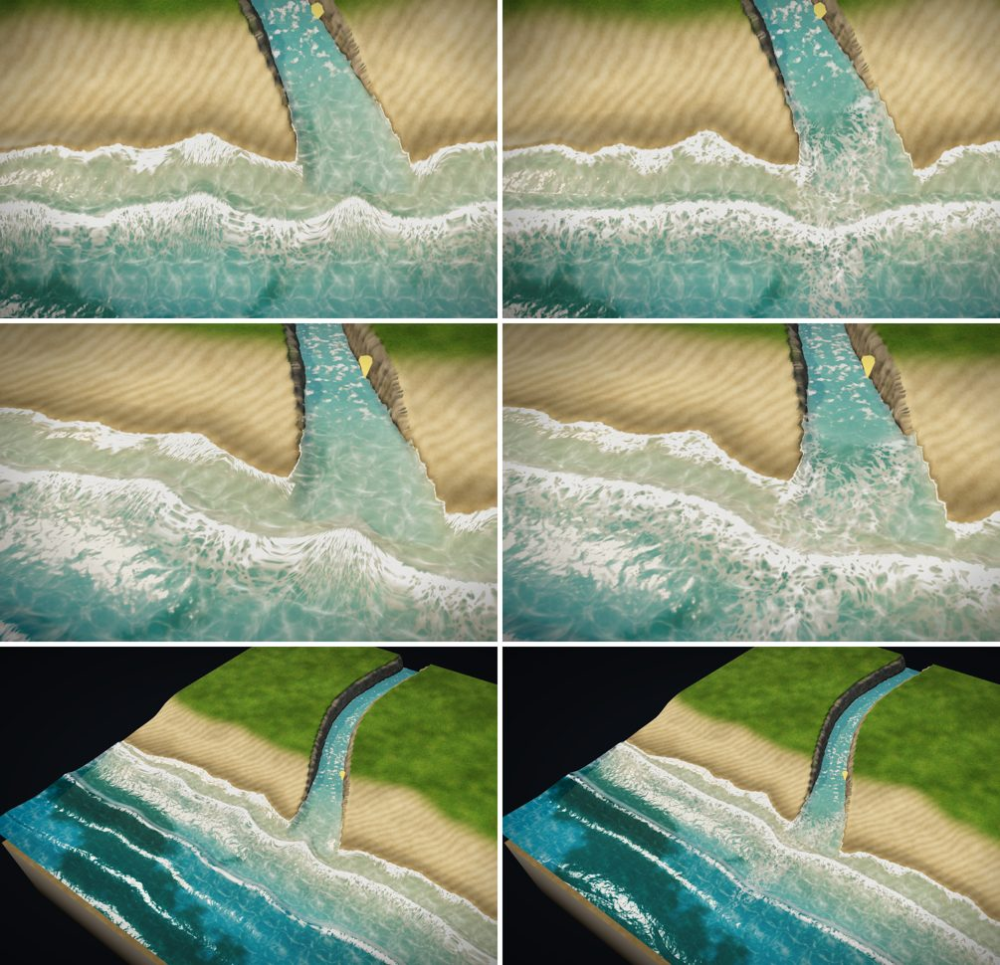
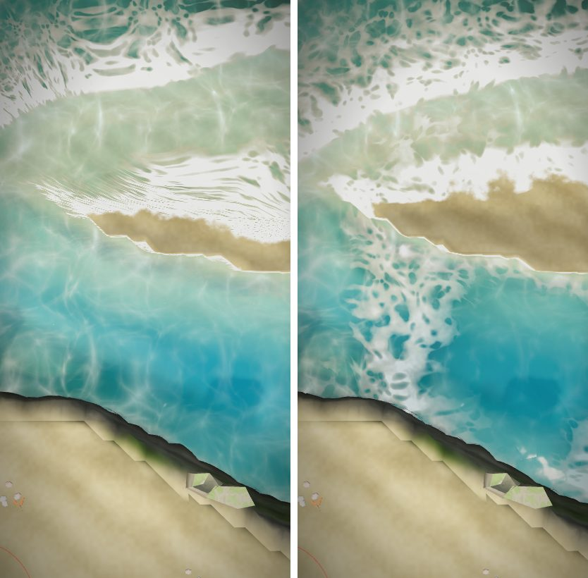

# マップエディター 修正報告（Revision 24）河口の波：川に入り込まず、川の流れに押し返される

ユーザーの指摘：「波の形がおかしい。地形に引っ張られ過ぎてる。河口では、津波でもない限り、川に波が入り込むんじゃなくて、川の流れが波を押し返す方が正しい。資料や動画を探してみて。」

## 調べた資料

実際に開いて読んだもの・見たものだけを挙げます。写真は見ただけで、素材としては使っていません。

- **Chawla, A. & Kirby, J. T.「Experimental Study of Wave Breaking and Blocking on Opposing Currents」**（ICCE、[PDF](https://icce-ojs-tamu.tdl.org/icce/article/download/5646/5316/23456)）
  - 波の向きと逆の流れ（河口など）は、波を遅くし、波を急にして、ときに砕けさせる。
  - 流れが十分に強いと、波のエネルギーが上流へ進めなくなる（群速度が 0 になる所で止められる）。止められる手前の波は急になる。
- **Zăinescu, F., Anthony, E. & Vespremeanu-Stroe, A.（2021）「River Jets Versus Wave-Driven Longshore Currents at River Mouths」**（Frontiers in Marine Science、[doi:10.3389/fmars.2021.708258](https://www.frontiersin.org/articles/10.3389/fmars.2021.708258/pdf)）
  - 逆向きの川の流れが十分に強いと、波は砕けるほど急になり、完全に止められることもある。止められなくても、多くのエネルギーを失う。
  - 河口の前の地形（河口の州）も、波の砕け方を大きく左右する。
- **「European Coasts - An Introductory Survey」波の屈折の章**（[kennisbank-waterbouw.nl](https://kennisbank-waterbouw.nl/EC/EC41.htm)）
  - 波の速さは水深で決まる。そのため、波の山は海底の等深線にそろうように曲がり、斜めに来た波も岸とほぼ平行になる。
  - 屈折が効くのは、海底の大きな形に対してです。
- **写真：Waikato 川の河口（ニュージーランド）の空撮**（Wikimedia Commons「Port Waikato NZ.jpg」）
  - 砕ける波の線は、海岸全体の向きに沿って、河口の前でもほぼまっすぐ続いている。川の中へ曲がって入り込まない。
  - 河口の前では、砕ける線が沖側へずれて乱れている。
  - 川の中は静かで、濁った川の水が扇形に海へ広がっている。
- 河口のドローン動画（例：Gualala 川の河口が大雨のあとで開いた空撮）は、検索で見つけましたが、この環境では再生して確かめられませんでした。

## 原因

- 波の山の位置を、「水際までの距離」の等高線そのものにしていました。
- そのため、波の山は海岸の小さな凹凸まで拾い、細い水路の中へも V 字に曲がって入り込んでいました。
- 川の流れが波に与える影響は、何も入れていませんでした。

## 直したこと

- **波の山の位置**（`app.js` の `computeShoreField`、`sea.js` の `seaH`）
  - 波の山は「波から見た海岸」に沿わせます。川・池・陸を全部海岸として扱い（河口は閉じる）、波長ほどの幅（約 4m）でならします。
  - そのため、波の山は河口の前でもまっすぐ通り、川の中へ入り込みません。海岸の小さな凹凸にも引っ張られにくくなりました。
  - 波が砕ける深さ・打ち上がり・水際の線は、これまでどおり実際の水深と水際で決めます。
  - 打ち上がりの時刻は、波打ち際での山の位置に合わせているので、つながったままです。
- **川の噴流**（河口から海へ出る川の流れ）
  - 海につながる川があると、河口から沖へ向かって、少しずつ広がりながら弱まる「噴流」の場を作ります（8m で半分の強さ）。
  - 噴流に逆らう波は遅くなるので、波の山は河口の前で沖側へ最大 3m 遅れます。山の線は、川へ入る V 字ではなく、沖へふくらみます。
  - 噴流の前の方では、波が急になって砕け、白い波が立ちます。
  - 噴流の中では、波は止められます。高さ・打ち上がり・波頭の泡が消えて、短く乱れた細かい波だけになります。
  - 噴流の水は、濁った緑がかった色になり、海底の光の網目は見えにくくなります。
- **泡の流れ方**
  - 泡の模様は「向き × 時間」で動かしていたため、向きが変わる所で、時間とともに引き伸ばされて筋になっていました（河口で目立ちました）。
  - 今は、4 秒ごとに動きをやり直し、半周期ずらした模様と重ねて切り替えます。いつまでたっても伸びません。

## 書き出しと Unity

- `sea_field2.png`（新規、海のある地図だけ）
  - R,G：波の山の位置 o（m、16 ビット、−40〜40）
  - B：川の噴流 j（0〜1）
  - 行の並びは `sea_field.png` と同じです（画像の上の行が Unity の z の最大）。
- `meta.sea.version` は 2 になり、`meta.sea.field2` と読み方（`encoding.field2`）が入ります。
- `MapWaterBuilder.BuildSea` は `sea_field2.png` を読み、メッシュの uv3 に (o, j) を入れます。古い書き出し（version 1）では 0 にするので、これまでの波になります。
- `MapSea.shader` は、uv3 を `seaWave` と `seaColor` に渡します。式は `sea.js` から作り直した `MapSeaShared.hlsl` で、エディターと同じです。
- 今回も、Unity でのコンパイル・実行はしていません。

## 確認

- `tests/sea_river.js`（10 項目すべて合格。今回 3 項目を足しました）
  - 波の山は、河口の前でも海岸に沿ってまっすぐ（沖 2〜6m の 3 本の線で、遅れを除いた山の位置の差が 0.5〜0.7m。水際までの距離そのものは、河口で 2.4m へこむ）。
  - 河口の前では、波の山が沖側へ 0.5〜0.9m 遅れる。
  - 川の噴流は河口の前に出て（河口で 0.68、沖 6m で 0.23）、16m 離れた浜には無い。
- `tests/sea_waves.js`（9 項目）：`sea_field2.png` も Unity（C#）と同じ読み方で読み、エディターの値と一致する（o の差 1cm 未満、j の差 0.005 未満）。
- `tests/sea_shore_seam.js`（4 項目）・`tests/sea_hlsl_sync.cjs`（13 項目）も合格。
- 浜辺のサンプルでも、河口の前で波が川へ入らず、白い波が立つことを画像で確かめました（上の 2 枚目）。
- 完成サンプル（`prepared/`）を作り直し、`--check` を通しました。

## 残っていること

- 噴流の強さは、川の幅や流れの速さによらず同じです。大きな川ほど強くする、という調整はしていません。
- 河口の州（川が運んだ砂がたまった浅瀬）の地形は作りません。地形はユーザーが作ったままです。
