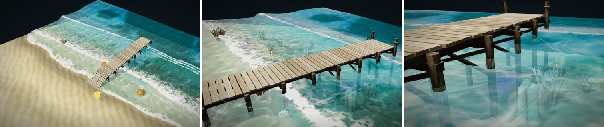
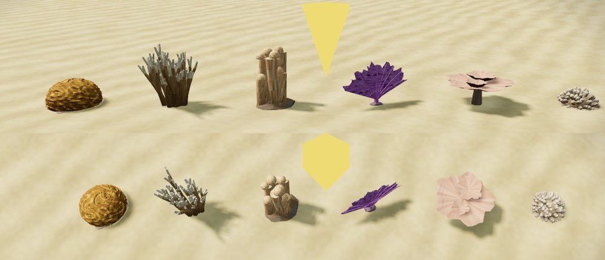
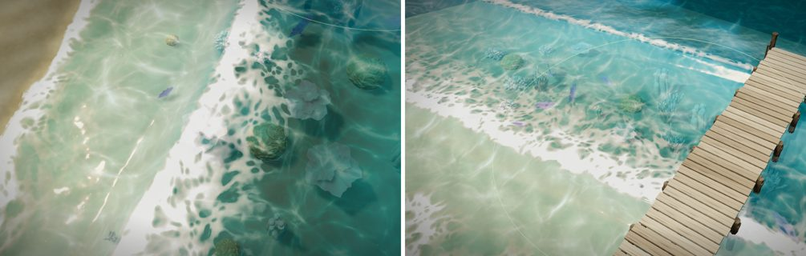

# マップエディター 修正報告（Revision 25）桟橋とコーラル

ユーザーの依頼：「桟橋を作って。その後、小物としてコーラルを複数。」

## 桟橋（橋の種類「桟橋」）

「橋」ツールの種類に「桟橋」を足しました。陸から水の上へドラッグします。

- **向き**
  - 桟橋は、陸（地面の高い方の端）から始まり、水の上で終わります。
  - 水の側から陸へドラッグしても、陸の端から始まる向きに直します。
- **床の高さ**
  - 陸の端では、橋と同じく地面の 0.12m 上に乗ります。
  - 最初の 2m で、静かな水面の 0.9m 上まで上がります。寄せる波より上です。
  - そこから先は平らに続きます。
- **形**（木の板の色と木目は、ほかの木の橋と同じ材質）
  - 床：横に並べた板（少しすき間あり）と、その下の縦の桁 3 本。
  - 杭：約 1.8m ごとに 2 本ずつ。上に梁、高い所には間に X 字の筋交い。
  - 杭の色：水の中は藻で暗い緑、水際はフジツボで白っぽい帯、その上は風雨で灰色がかった木。
  - 先端：杭がそのまま床の上へ伸びた係留柱（ロープを巻いた物が 1 本）と、片側に水へ下りるはしご。
  - 陸の端：石の土台。
- **歩く**：床の上は、陸から先端まで歩けます。先端から水へは、深いので下りられません。
- **検証**：ほかの橋は両端の段差を検査します。桟橋は先が水の上で終わるので、先端の段差は検査しません。
- **書き出し**：`meta.json` の `bridges` に `type: "pier"` と、上り坂の長さ `rampLength` が入ります。`deckCurve` に床の形の読み方を書きました。

## コーラル（小物 6 種、グループ「海の生き物」）

実在のサンゴの形を、写真と説明で確かめてから作りました。写真は Wikipedia・Wikimedia Commons の物を見ただけで、素材としては使っていません。

| 名前 | id | 形（参考） |
|---|---|---|
| ノウサンゴ | `braincoral` | ほぼ球のドームに、迷路のように曲がりくねった溝と稜。黄土色（グルーヴド・ブレインコーラル *Diploria labyrinthiformis*） |
| 枝状ミドリイシ | `staghorn` | 太い枝が上へ伸びて二股に分かれ、鹿の角のような茂みになる。枝先が白っぽい（スタッグホーンコーラル *Acropora cervicornis*。高さ 2m を超えることもある） |
| ハシラサンゴ | `pillarcoral` | 枝分かれしない太い指のような柱が、一つの根元から何本も立つ。先は丸く、黄褐色（ピラーコーラル *Dendrogyra cylindrus*） |
| ウミウチワ | `seafan` | 縦に平たい扇。太い枝が放射状に広がり、間を細かい網目が埋める。紫（コモンシーファン *Gorgonia ventalina*） |
| テーブルサンゴ | `tablecoral` | 短い柄の上に、縁が波打つ平たい円い板が広がり、小さな板が重なる。桃色がかった黄褐色（*Acropora hyacinthus*、豪州ロードストーン礁の写真） |
| 丸いサンゴの群体 | `roundcoral` | 短い太い小枝がびっしり集まった、カリフラワーのような丸い塊（同じ礁の写真に多い丸い群体。種は特定していません） |

- **置ける場所**
  - 浜辺・磯のバイオームの小物です。
  - 水の中、静かな水面からの深さ 0.25〜3m にだけ撒かれます（種類ごとに少しずつ違います）。
  - 小物に `water: [最小の深さ, 最大の深さ]` という項目を足し、撒く処理（`canPlace`）が見るようにしました。
  - 撒くときは、てっぺんが静かな水面の下に収まるよう、浅い所では小さくします。小さくしても収まらない所には置きません。
  - 海は深くなるほど不透明なので、浅い所の方がよく見えます。
- **海岸ツール**：やり直しても、水の中の小物（コーラル）は消しません。
- **当たり判定**：歩ける浅瀬では障害物になるよう、円の判定があります（ウミウチワだけ細く 0.15m）。
- **揺れ**：ウミウチワは少し揺れます（風の揺れと同じ仕組み）。
- **Unity**：ほかの小物と同じく、位置・向き・大きさ（`props.csv`）と、当たり判定の目安（`asset_catalog.json`）を書き出します。見た目は Unity の Prefab で作ります。

## 確認

- `tests/pier_coral.js`（新規、10 項目すべて合格）
  - 桟橋を水から陸へドラッグしても、陸の端から始まる。
  - 床は陸の端で地面の 0.12m 上、水面の 0.9m 上まで上がって平らに続く。
  - 歩くモードで、陸から先端まで歩ける（床の高さ 0.9m のまま）。
  - 検証は先端の段差を言わない。
  - コーラル 6 種が「海の生き物」のグループにある。
  - 陸と海にまたがって撒くと、水深 0.25〜3m の所にだけ置かれる（6 種すべて）。
  - どのコーラルも、てっぺんが静かな水面の下にある。
  - 海岸ツールをやり直しても消えない。
  - 保存・読み込みで戻り、`meta.json`（桟橋）・`asset_catalog.json`・`props.csv`（コーラル）に入る。
- 既存の `tests/editor_ui.js`（11 項目）・`tests/map_name_light.js`（12 項目）も合格。
- `tests/rev3_acceptance.js` は、修正前の版と同じく「崖の岩を調整中です」で止まります（前からある失敗。今回の変更で新しく増えた失敗はありません）。
- 完成サンプル（`prepared/`）を作り直し、`--check` を通しました。既定のサンプルがエラー無しで開けることも確かめました。

## 残っていること

- ウミウチワの網目は色で描いています。穴が透けて向こうが見えることはありません。
- エディターの海は深いほど不透明なので、深めの所のコーラルは見えにくいです。水を澄ませる調整はしていません（海の見た目が変わるため）。
