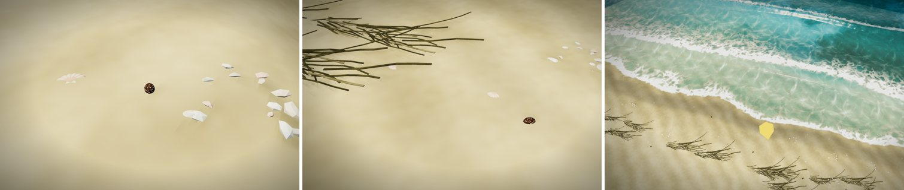

# マップエディター 修正報告（Revision 26）波打ち際の貝殻と打ち上げられた海藻

ユーザーの依頼：「波打ち際に、小さな貝殻などが欲しい。」

## 足した小物（グループ「海の生き物」、浜辺・磯）

実物の形を、Wikipedia・Wikimedia Commons の説明と写真で確かめてから作りました。写真は見ただけで、素材としては使っていません。

| 名前 | id | 形（参考） | 置ける高さ（静かな水面から） |
|---|---|---|---|
| ホタテの殻 | `scallop` | 扇形の片殻。放射状の筋と波形の縁、蝶番の両側の小さな「耳」。クリーム色に橙〜桃色の帯（*Argopecten irradians* の写真） | −0.05〜0.45m |
| タカラガイ | `cowrie` | つやのある卵形のドーム。濃い茶色に白い斑点（*Cypraea caputserpentis* の写真） | −0.05〜0.45m |
| 貝のかけら | `shellbits` | 白・クリーム・淡い桃色の小さな破片が散らばる（種は特定しない） | −0.05〜0.45m |
| 打ち上げられた海藻 | `wrack` | 満ち潮の跡に残る、もつれた黒っぽい海藻の帯。小枝と殻のかけらが混じる（海藻の打ち上げ線の写真） | 0.3〜0.65m |

- 大きさは、上から見える大きさにするため、実物の大きい方に合わせました（ホタテは直径 13〜21cm ほど、タカラガイは長さ 8〜13cm ほど）。
- どれも当たり判定はありません（小石と同じ）。
- 地面に置くとき、既定では 5cm 沈めます。このままでは小さな殻が埋もれてしまうので、3〜4mm だけ沈めるようにしました。
- 巻き貝も作りたかったのですが、写真の取得が回数制限で止まり、形を確かめられませんでした。資料を見ないまま作ることはせず、今回は入れていません。

## 置き方

- 小物に `shore: [低い方, 高い方]`（静かな水面からの高さ、m）という項目を足しました。撒く処理（`canPlace`）は、その高さの帯にだけ置きます。
  - 貝殻：打ち上がりが届く帯（水際〜0.45m）
  - 海藻：その上の満ち潮の線（0.3〜0.65m）
- 撒くツールで、好きな所に撒けます（帯の外には置かれません）。
- **海岸ツールで浜を作ると、自動で少し並びます。**
  - 貝殻は、打ち上がりの帯に、0.7m の格子のおよそ 14% の点に置きます。3 種から選びます。
  - 海藻は、0.36〜0.52m の細い帯に集めて置き、浜と平行に向けます。そのため、一本の打ち上げ線に見えます。
  - 置くのは、海の浜（海の重みのある所）だけです。内陸の池のまわりには置きません。
  - 海岸ツールをやり直しても、同じ所には重ねないので、数は増えません。
  - 海岸ツールでやり直しても、これらは消しません。
- 浜辺・磯のサンプル（海岸ツールを使う）にも、自動で並びます。

## 確認

- `tests/strandline.js`（新規、8 項目すべて合格）
  - 海岸ツールで、ホタテ・タカラガイ・貝のかけら・海藻が並ぶ（貝 43 個・海藻 36 個）。
  - どれも、それぞれの高さの帯にある。
  - 海藻は浜と平行（海への向きとの内積は 0.16 以下）。
  - 内陸の池のまわりには無い。
  - やり直しても数が同じ（79 → 79）。
  - 撒くツールでも帯にだけ置ける。
  - 当たり判定が無い。
- 既存の `tests/pier_coral.js`（10 項目）・`tests/editor_ui.js`（11 項目）・`tests/map_name_light.js`（12 項目）も合格。
- 完成サンプル（`prepared/`）を作り直し、`--check` を通しました。
