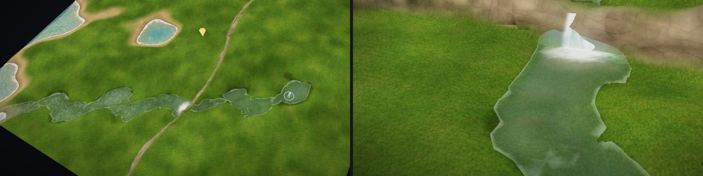
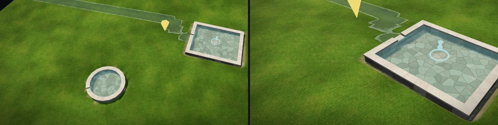
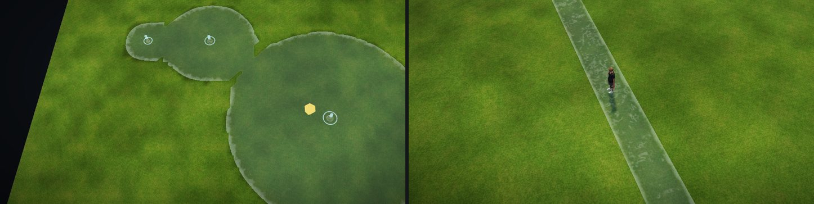

# マップエディター 修正報告（Revision 28）水源とプール

ユーザーの依頼：「水源みたいなのって作れる？湧出量に応じて、平地なら一定まで広がる。低い所があればそっちに向かって流れる。湧水から流れる小川とか、地上の高さのプールとか作れるようにしたい。（中略）あくまでもスマホでもプレイ可能なアクションRPGを作るのが目的。」

決めてもらったこと：
1. 湧出量はプリセット
2. 小川の溝は自動で掘る
3. プール部品も作る
4. スイッチ（水を止める・流す）は今は無し（ランダムダンジョンが基本のため）

## 考え方：流体のシミュレーションはしない

水を動かして計算すると重く、スマホでは遊べません。そこで、水源・地形・プールが変わったときに一度だけ計算して、結果を静的な水面として置きます。ゲーム中は何も計算しません（水面の細波・泡は、ほかの水と同じくシェーダーで動かすだけ）。

湧出量は「濡らしておける面積（m²）」に置き換えます。水面からの蒸発や地面への浸み込みは面積に比例する、と考えたときの釣り合いです。

| 湧出量 | 目安の湧出量 | 濡らせる面積 | 小川の幅（湧き口） |
|---|---|---|---|
| しずく | 0.2 L/s | 10 m² | 0.35m |
| 小川 | 3 L/s | 70 m² | 0.75m |
| 泉 | 12 L/s | 260 m² | 1.45m |
| 大きな泉 | 40 L/s | 900 m² | 2.4m |

水の配り方（`springs.js`）：

1. 水源から、一番急に下がる隣へ小川として流れます。川幅ぶんの面積を払うので、下流ほど水が減って細くなり、面積が尽きた所で地面に浸み込んで消えます。
2. それ以上下がれない所（くぼみ）では池になります。低い所から順に池へ足していき、平らな所では丸く広がって、面積が尽きた所で止まります。
3. 池の縁で、水面より低い所が見つかったら（あふれ口）、そこから小川として流れ続けます。
4. ほかの水源の水にぶつかったら合流し、残りの面積をその先へ渡します。同じ高さになった池どうしは 1 つの池になります。
5. 地図の端、水位より低い水（池・川・海）、あふれ口の無いプールで終わります。

考え方の元：Barnes, Callaghan & Wickert (2021) "Computing water flow through complex landscapes – Part 3: Fill–Spill–Merge"（https://esurf.copernicus.org/articles/9/105/2021/ ）。ここでは雨ではなく水源の水を、量ではなく面積の予算で扱う簡易版です。

## 水源ツール（キー `@`）

- クリックした所から水が湧きます。湧出量は下の「湧出量」から選びます。
- 置いた水源をもう一度クリックすると、湧出量を今の種類に変えます。
- Shift+クリックで、近くの水源を消します。
- 編集中は、水色の輪としずくの印が出ます（歩くモードでは出ません）。
- 湧き口では、水がわき上がる模様と、外へ広がる小さな輪が動きます。
- 水位より低い所（水の中）と、溶岩のバイオームには置けません。

### 小川の溝（自動）

- 水源を置く・湧出量を変える・消すたびに、小川の川床を掘り直します。深さは 0.08〜0.22m（流れが多いほど深い）。岸は 0.8m かけて元の地面に戻ります。
- 掘った量は別に覚えておき（`springCarve`）、掘り直す前に一度元に戻します。なので、湧出量を何度変えても溝は深くなり続けず、水源を消すと溝は埋め戻されます。
- 掘った所をブラシで直すと、そこは手で作った地形として扱い、あとで埋め戻しません。
- 地面に浸み込んで終わる小川は最後の 2m で溝が浅くなって消え、池や海へ入る小川は溝をその先まで延ばします。

### 見た目

- 水面は、ほかの水（池・川）と同じシェーダーです。流れの画像に水源の流れも書き込むので、細波・泡は下流へ運ばれます。
- 小川は数 cm の澄んだ水で、川底が見えます。川底は砂利の色になり、岸は湿った色になります（地形のシェーダーに「水源の水面からの高さ」を頂点ごとに渡しています）。
- 小川が崖を落ちる所（1 歩で 0.8m 以上下がる所）には、置いた滝と同じ水の幕・泡・しぶきを自動で付けます。
- 平らな所の池の縁は、0.5m の格子の段が出ないよう、水深を少しぼかして丸くしています。

### 歩く

- 通行判定と歩く速さは、その場所の水面（地図の水位か、水源の小川・池・プールの高い方）で決めます。
- 深さが体格の「歩ける水深」（標準 0.9m）より深い池の中ほどは歩けません。
- 浅い小川は歩けて、深さが 0.15m を超える所では速さが半分になります（ほかの水と同じ）。
- 小物を撒くときも、水源の水の中と、そのすぐ岸には陸の小物を置きません。水を置いたとき、水に入った陸の小物は消します（水草・コーラルなど水の小物は残します）。

## プールツール（キー `:`）

- 角から角へドラッグすると、石の縁で囲んだプールを地面の上に作ります。形は「プールの形」から、四角か丸（ドラッグした四角に内接する楕円）。一辺 1.6〜16m。
- 中の床は、プールの下で一番低い地面の高さに平らにならし、石畳を塗ります。
- 縁石は床から 0.45m の高さ、厚さ 0.35m。上に少し張り出した笠石を載せます。地面の中まで 0.35m 埋めてあるので、斜面でもすき間ができません。
- 水は縁の 10cm 下まで張ります（深さ 0.35m）。水源が無くても水は張ってあります。
- あふれ口：外の地面が一番低い側の縁の真ん中に、少し低い切り欠きを付けます。中に水源を置くと、そこから小川が流れ出ます。
- 縁石の上は狭くて通れません（障害物）。中の水は浅いので歩けます。
- Shift+クリックで近くのプールを消します（ならした床はそのまま。取り消しで戻せます）。
- 水の中、地図の端から 1m 以内、ほかのプールと重なる所には作れません。

## 保存・取り消し・書き出し

- 保存：`map.json` に `springs`・`pools`・`springCarve`（溝の深さ）が入ります。どれも、無いときは何も書きません（今までの地図はそのまま）。
- 取り消し・やり直し：水源・プール・溝も戻ります。
- 書き出し（水源かプールがあるときだけ）
  - `spring_water.png`：水源の水面の高さ（16bit）と種類（小川・池・プール）。符号は `meta.springs.encoding`。
  - `spring_flow.png`：水源の水の流れ（`water_flow.png` と同じ形式）。
  - `meta.springs`：水源（湧出量・行き先）、池、小川の線（水面の高さ・幅・水深）、滝。
  - `meta.pools`：プールの形・大きさ・床・縁・水面の高さ・あふれ口の向き。縁石は、橋と同じくゲーム側でこの値から作ります。
  - `walkable.png` の G：縁石の上は 40。

## Unity（`MapWaterBuilder`）

- 書き出しに `meta.springs` があると、"Springs" を作ります。`spring_water.png` の高さで、水のある所だけの格子のメッシュを作り、ほかの水と同じ `MapWater/Water` を付けます。水深の画像（水面 − 地形）は `SpringDepth` として作ります。
- プールの水面は、内側の平らな面として同じメッシュに入れます。
- 水位の水（池・川・海）が無い地図でも作ります。
- この環境には Unity が無いので、C# はコンパイルしていません。

## スマホ

- 計算は、置いたとき・地形を変えたときだけです（128m の地図に大きな泉 6 つで約 20〜40ms）。
- 描くのは水面の網 1 つ（水のある所の三角形だけ）と、プールごとの縁石と水面です。材質は今の水と同じ 1 つで、シミュレーションはありません。

## 確認

- `tests/springs_unit.cjs`（新規、25 項目すべて合格）：平地で湧出量の面積まで丸く広がる、プリセットの順、斜面を流れて下流ほど細い、しずくは途中で消える・大きな泉は地図の端まで、深い鉢は面積で止まる、浅いくぼみは満ちてあふれる（あふれた小川は池の水面より上がらない）、合流で池が広がる・隣のくぼみまで満ちると 1 つの池、水位の水で終わる、水の中の水源は警告、プール（決まった水面・あふれ口・出口なし）、溝（深さ・池は掘らない・掘った後も同じ所を流れる）、同じ入力から同じ結果、速さ。
- `tests/springs_editor.js`（新規、14 項目すべて合格）：西へ流れて溝を掘る、くぼみが池になる、深い池は歩けず浅い小川は歩ける、湧出量を変えて戻すと地面も元どおり、消すと埋め戻す、平らな所は湧出量の広さ、プール（床・水面・縁は通れない・中は歩ける・あふれ口から小川・小さすぎるプールは作らない）、保存・読み込み、書き出し（画像からプールの水面の高さが 1cm 以内で読める）、取り消し・やり直し、ページのエラーなし。
- これまでの試験：`sea_river.js`・`sea_waves.js`・`strandline.js`・`pier_coral.js`・`water_unit.js`・`sea_hlsl_sync.cjs`・`room-package.cjs` は合格。
- 完成サンプル（`prepared/`）は、スクリプトの版が変わったので作り直しました。`--check` 合格。既定のページで読み込み（10.5 秒、小物 5761 個、エラーなし）。
- `water_export.js` は、元の版（変更前）でも「テスト中のページ移動」のエラーで最初に止まります。今回の変更とは関係ない既存の問題で、今回は確認できていません。

## 今回やっていないこと

- 水を止める・流すスイッチ（決めてもらったとおり、今は無し）。
- プールに入る階段。縁石は通れないので、プールの中へは歩いて入れません。
- 縁石の Unity 用のメッシュ（橋と同じく、`meta.pools` の形からゲーム側で作る前提）。
- 水源の水を、水位の水（池・川）の流れの計算（`water.js`）にはつないでいません。小川が池や川に入る所で、そちらの流れは変わりません。
