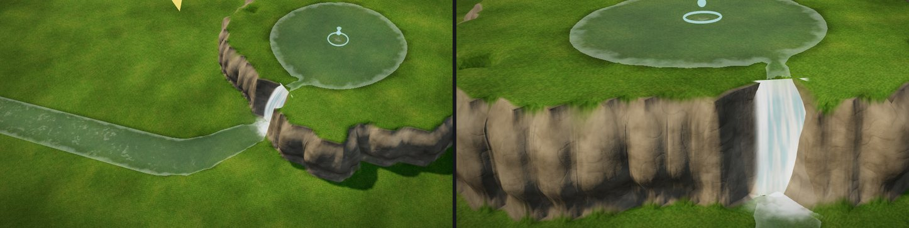

# マップエディター 修正報告（Revision 29）水源の滝と、置いた滝の付け直し

ユーザーの依頼：
- 「水源から出た水、滝の部分とかうまくいってないね。ブラッシュアップして改善よろしく。」
- 「水の無いところに滝を設置して、その後掘っていって水の高さまで行くと、滝が空中に浮いたままだね。」

## 水源の滝：何がおかしかったか

台地ツールで作った崖の上に水源を置いて確かめると、次のようになっていました。

- **滝の幕が崖に埋もれていた**
  - 幕を崖の縁の位置に縦に立てていました。
  - そのため、崖石の小物と岩肌の凹凸の中に入って見えませんでした。
  - 崖の上には、幕のてっぺんの白い所だけが横向きの帯のように浮いて見えました。
- **崖の面に水の板が貼りついていた**
  - 小川の水面を、崖の斜面にもそのまま描いていました。
  - 崖の途中に、薄い水色の三角形が出ていました。
- **落ちた先に何も無かった**
  - 滝つぼも泡も波紋も無く、ただの小川に続いていました。

## 直したこと

- **崖の面には水面を描かない**（`springs.js`）
  - 小川が 1 歩で 0.8m 以上下がる所を滝とします（続けて急な所は 1 つの滝にまとめます）。
  - 縁（lip）から滝つぼ（foot）までの区間では、小川の水面を描きません。
  - 縁と滝つぼを結ぶ帯の中で、上と下の水面の間の高さにある崖の面のセルにも、水を置きません。
- **滝の幕は、滝つぼから崖の縁へ弧を描く形**
  - 幕の下端は滝つぼに立ちます。上端は崖の縁の少し手前（約 0.2m）まで寄せます。水が縁から前へ飛び出して落ちる形です。
  - 上端は小川の水面より少し下にしました。崖の縁の丸みに隠れた幕の、てっぺんだけが地面から出る、ということはありません。
  - 幕・泡・しぶきは、置いた滝と同じ物です。しぶきは置いた滝と同じく揺れます。
- **幕の通り道の崖石を片づける**
  - 置いた滝と同じく、滝の帯に入る崖石・岩の小物を消します（位置か、石の輪郭のどこかが帯に入る物）。
  - 滝の帯では崖の岩肌の凹凸を作りません（置いた滝と同じ仕組み）。
- **滝つぼと泡**
  - 落ちた所を丸く掘ります。深さは滝の高さに応じて 0.25〜0.5m です。
  - 滝つぼの水面には、置いた滝と同じ波紋の輪が広がります。
  - 滝つぼのまわりから下流へ数 m、泡の帯が流れに乗って流れます。泡の帯は流れの画像の mask の R で、`water.js` の泡の帯と同じ仕組みです。
- **書き出し・Unity**
  - `meta.springs.falls` に、滝つぼの位置 `foot` と、縁から滝つぼまでの水平の距離 `lean` を足しました。
  - 泡の帯を `spring_mask.png`（`water_mask.png` と同じ形式）として書き出し、Unity の水源の水の材質に付けます。
  - `MapWaterBuilder` は、水源の滝にも置いた滝と同じ幕（`MapWater/Fall`）と飛沫（`MapWater/Splash`）を作ります。
  - 幕を縁へ寄せるため、`MapWaterMeshes.FallSheet` に `lean` の引数を足しました。省略時は 0 で、置いた滝の幕はこれまでと同じです。
  - この環境には Unity が無いので、C# はコンパイルしていません。

## 置いた滝が宙に浮く

- 置いた滝の落ち口と着水点の高さは、置いたときに一度決めたきりでした。
- そのため、あとで滝の下を掘っても、滝は元の高さのまま浮いていました。
- ブラシで地形を変え終えたとき（ストロークの終わり）に、置いたときと同じ測り方で付け直すようにしました。
  - **着水点**：崖の点から下流へ 0〜3m の一番低い地面。ただし水位より下へは行かず、水があればその水面になります。
  - **落ち口**：崖の点から上流へ 0〜3m の一番高い地面。崖の上を削ったり盛ったりすると付いてきます（15cm 以上変わったとき）。
- 掘っていって水の高さまで届くと、滝の下端は水面まで下がります。埋め戻すと、地面まで上がります。
- 地図を読み込んだときには付け直しません。保存した地図や完成サンプルの滝は変わりません。

## 確認

- `tests/spring_falls.js`（新規、10 項目すべて合格）
  - 水源の小川が台地の崖を越える所が滝になる。
  - 崖の面に水の板を貼らない。
  - 幕は滝つぼから縁の高さまでで、縁より上に出ない。
  - 幕・泡・しぶきと、滝つぼの波紋がある。
  - 幕の通り道に崖石を残さない。
  - 水源を消すと滝も消える。
  - 置いた滝を乾いた所に置き、着水点を水位の下まで掘ると、滝の下端が水面（0.8m）まで下がる。
  - 埋め戻すと、下端が地面まで上がる。
  - ページのエラーなし。
- `tests/springs_unit.cjs`（3 項目を追加して 28 項目、すべて合格）
  - 2.5m の崖を越える小川が 1 つの滝になり、滝つぼの位置と向きを持つ。
  - 崖の面には水面を置かない。
  - 滝つぼを 0.25m 以上掘り、そのまわりに泡の帯ができ、遠くには無い。
- これまでの試験：`springs_editor.js`・`sea_waves.js`・`strandline.js`・`pier_coral.js`・`water_unit.js` は合格。
- 完成サンプル（`prepared/`）は作り直しました。

## やっていないこと

- 崖の途中の段（何段にも分かれた滝）は、続けて急な所を 1 つの滝にまとめて描きます。
