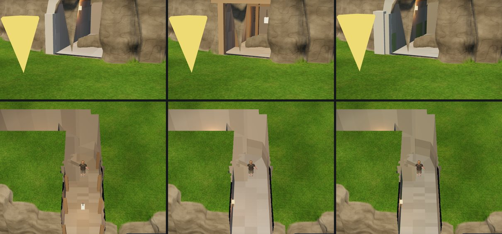

# マップエディター 修正報告（Revision 30）トンネル

ユーザーの依頼：「トンネルツールが欲しい。横に掘っていくの。関連して必要になってくるものを考え、実装計画を立てて。」

決めてもらったこと：
1. 中の見え方は、屋根の透かし
2. ゆるい勾配あり
3. 見た目は 4 種類すべて（素掘り・石積み・坑道・遺跡）
4. 奥の小部屋は不要

## 考え方

地形は「高さの格子」なので、上に地面が残る横穴はそのままでは表せません。そこで、トンネルは地形とは別の物として持ちます。

- 地形の高さは変えません。
- トンネルの中の床・壁・天井は、別の網で作ります。
- 地形に穴を開けるのは、入口（口）と切り通しの所だけです。
- 穴を開けたセルは、地形と同じ材質の細かい網（口のまわりの地面）で作り直し、アーチの口の部分だけ抜きます。崖の色も、上の草も、そのまま口のまわりまで続きます。

トンネルの中心線は 0.25m ごとに区切り、真上の地面の高さで次の 3 つに分けます（`tunnels.js`）。

| 区間 | 真上の地面 | 作る物 |
|---|---|---|
| 外 | 床とほぼ同じ高さ | 何も作らない（地面を歩く） |
| 切り通し | 床と天井の間 | 床と、地面より下の部分の壁（岩を掘った面） |
| トンネル | 天井より上 | 床・壁・アーチの天井 |

## トンネルツール（キー `^`）

- **掘る**：崖や斜面の前の地面から、山の中へドラッグします。床の高さは入口の地面と同じです。
- **続きを掘る**：掘った先の端からまたドラッグすると、続きを掘ります（曲がり角になります）。「横に掘っていく」使い方です。
- **枝分かれ**：トンネルの途中からドラッグすると、本線の床の高さで枝分かれします。分かれ目では、本線の壁に口が開きます。
- **出口**：反対側の地面まで掘ると出口になります。床はその地面の高さに合わせて上り下りします（勾配 15° まで。それより急だと掘りません）。
- **大きさ**：細い（1.6×2.4m）・ふつう（2.4×2.8m）・広い（3.2×3.4m）。
- **勾配**：水平・ゆるい上り（5°）・ゆるい下り・上り（10°）・下り。山の中の区間の上り下りです。
- **見た目**：下の表の 4 種類。
- **消す**：Shift+クリックで、近くのトンネルを 1 本消します。
- **編集中の表示**：山の中を通る区間は、地面の上に水色の点線で見えます。トンネルの上にカーソルを合わせると、屋根を透かして中が見えます。
- **掘れない所**：水位より低い床、地図の端から 1m 以内、溶岩のバイオーム。

| 見た目 | 中 | 入口 |
|---|---|---|
| 素掘り | でこぼこの岩肌、土の床 | 岩の口だけ |
| 石積み | 石の段の壁、敷石の床 | 迫石のアーチと要石、両側の柱 |
| 坑道 | 岩肌と、1.8m ごとの木の支保工（柱と梁）、吊るしたランタン | 木の枠 |
| 遺跡 | 緑がかった石と苔 | アーチ、太い柱と楣石（片方の柱が崩れていることもある） |

## 関連して直したこと・足したこと

- **歩く**
  - 中の床はトンネルの床です（真上の地面ではありません）。壁の外へは出られません。
  - 入口の手前 1m も床の高さで歩けます（崖のすそは急で、地面としては歩けないため）。
  - トンネルの屋根の上の地面も歩けます。歩くモードでは、主人公の高さで「中の床」か「上の地面」かを選ぶので、2 層になります。
  - 通行判定の画像（`walkable.png`）と床の画像には、中の床が入ります（上の地面は入りません）。
- **中の見え方（透かし）**：主人公が屋根の下にいる間は、頭より上にある物を次の範囲だけ描きません。
  - トンネルの真上（壁の内側）を、主人公から 7m まで。
  - カメラから頭への線のまわり 1.1m。
  - 山の上の木や草も、その範囲では消えます。
  - 編集中も、トンネルツールでトンネルの上にカーソルを合わせると、同じように透けます。
- **暗さと灯り**
  - 入口から奥へ行くほど暗くなります（網の色に焼き込み。地形の影は受けません）。
  - 入口から 2m より奥に、約 7m ごと、左右交互に灯りを付けます（坑道は梁から吊るしたランタン、ほかは壁の松明）。
  - 灯りは、ほかの灯りの小物と同じく近くを照らします。
- **口のまわり**
  - 崖石・岩の小物を片づけます。
  - 崖の岩肌の凹凸を作りません（滝と同じ扱い）。
  - 口と切り通しに入った小物は消します。
- **検証**：書き出しの前に警告します。
  - 天井が体格の身長＋0.2m より低い。
  - 勾配が 15° を超える。
  - 床が水位より低い。
  - 上に地面がかぶる所が無い（切り通しだけ）。
- **保存・取り消し**：`map.json` に `tunnels` が入ります（無いときは書きません）。取り消し・やり直しも効きます。

## 書き出し・Unity

- **書き出し**
  - `tunnels_mesh.json`：床・壁・天井・枠・灯り・口のまわりの地面（cap）の網です。Unity の座標で、頂点の色つき、部分網ごとの三角形です。
  - `holes.png`：トンネルの口と切り通しのセルが入ります（隠し通路と同じ画像）。
  - `meta.tunnels`：中心線・幅・高さ・種類・口の位置と向き・灯り。
  - `meta.tunnelRules.cutaway`：透かしの決まり。
  - `walkable.png` の G：トンネルの床は 56。
- **Unity**（`unity/Assets/MapTunnels`）
  - `MapTunnelBuilder.Build(書き出しのフォルダ)`：網、当たり判定（床・壁・天井・口のまわりの地面）、灯りの Point Light、透かしの部品を作ります。
  - `MapTunnels/Tunnel` シェーダー：頂点の色と光で描きます。両面を描き、透かしにも対応しています。
  - `MapTunnelCutaway`：主人公とカメラを入れると、エディターと同じ規則で屋根を透かします。
  - 地形（Terrain）の穴は、`holes.png` をゲーム側で `TerrainData.SetHoles` に入れます（隠し通路と同じ）。
  - Unity の標準の Terrain の材質には透かしが入っていないので、地面も透かすには、地形の材質に同じ判定を入れる必要があります。
  - この環境には Unity が無いので、C# とシェーダーはコンパイルしていません。

## Revision 28 の抜けの修正

- プールツールは、ドラッグの開始点を記録する処理から漏れていました。そのため、画面上でドラッグしてもプールが作られませんでした（試験は関数を直接呼んでいたので見逃していました）。
- 直したうえで、今回の試験では実際のマウスのドラッグで作れることを確かめました。

## 確認

- `tests/tunnels_unit.cjs`（新規、14 項目すべて合格）
  - 区間の分け方、奥行き、床の問い合わせ、地形の穴は口だけ、口のまわりの地面（口の中は抜く）。
  - 網（床・壁・天井。数値が有限・高さと幅が正しい）、灯り、4 種類の見た目、枝分かれで壁に口が開く。
  - 検証の警告 4 種類、速さ（60m のトンネル 4 本で約 40ms）。
- `tests/tunnels_editor.js`（新規、16 項目すべて合格）
  - マウスのドラッグで掘る、端から続きを掘って反対側へ抜ける、地形の穴は 2 つの口だけ、口のまわりの崖石を片づける。
  - 中の床と壁、網と灯り、枝分かれ。
  - 歩くモードで外から歩いて入り透かす、台地の上はトンネルの上を渡れる。
  - 編集中の透かし、取り消し・やり直し、保存・読み込み。
  - 書き出し（網・meta・穴・`walkable.png` の 56・警告なし）、プールをマウスのドラッグで作れる、ページのエラーなし。
- これまでの試験：`springs_unit`・`springs_editor`・`spring_falls`・`sea_waves`・`strandline`・`pier_coral`・`mobile_walk` は合格。
- 完成サンプル（`prepared/`）は作り直しました。

## 今回やっていないこと

- トンネルの中への小物の置き方：置くツールのクリックは山の上の地面に当たるので、中の床には置けません（灯りは自動で付きます）。
- 水没したトンネル（床が水位より下）。
- 水源の水はトンネルに入りません（地面の上だけを流れます）。
