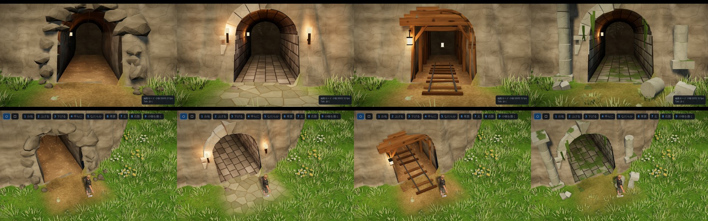

# マップエディター 修正報告（Revision 31）トンネルの入口のブラッシュアップ

ユーザーの依頼：
- 「入り口付近しか使う予定はないから、奥にこだわらなくてもよい。入口付近のグラフィックをブラッシュアップ、クオリティアップしていって。」
- 「てか上から伸びてる三角はなんなの？削除して。」

## 上から伸びていた三角形

- **正体**：口のまわりに作り直した地面の網（Revision 30 の「cap」）の一部でした。
- **原因**
  - 地面を 12.5cm 角の四角に分け、四角の中心が口の外なら残す、という粗い判定でした。
  - 急な崖の面では、四角の上の角が口の外、下の角が口の中、ということが起きます。
  - そのため四角が残り、口の中へ細長い三角形が垂れ下がっていました。
- **直し方**：口の輪郭（床からアーチまでの断面）で、地面の網を正確に切り抜くようにしました。
  - 輪郭をまたぐ四角だけを、さらに 4 分の 1（約 3cm）まで分けます。
  - そのうえで、輪郭の線で切ります。
  - 単体試験で、残った三角形のどの点も口の中に入らないことを確かめています。

## そのほかの、入口の形の直し

| 前 | 後 |
|---|---|
| 真上から見ると、白い天井の破片が崖の上に突き出していた | 壁・天井は、地面と交わる線で切り落とします（以前は四角ごとに残すか消すかだけでした） |
| 崖が口を斜めに横切ると、片側の崖のすそが口の中へ食い込んでいた | 口の始まりを、幅の左右の地面でも判定します。地形の穴も、口の断面に食い込む所すべてに開けます |
| 口の手前の床の縁に黒いすき間が見えた | 床を口の外へ 0.5m 延ばし、地面に沿わせて地面の下へもぐらせます |
| 内側が白っぽく、紙を折ったような見た目 | 下の「質感」を参照 |

## 質感（エディターのトンネルの材質）

トンネルの網は、部分ごとに「材質」を持ちます。模様は描くときに計算します。

| 材質 | 見た目 |
|---|---|
| 岩肌（素掘り・坑道の壁、ふちの岩） | 崖の地形と同じ式の岩（鉱物のむら・地層・石の粒）。マップの岩の色合いにも従います |
| 石積み（石積み・遺跡の壁） | 長さ 0.62m・高さ 0.4m の段、目地はくぼみ、石ごとに色が少し違う |
| 敷石（石積み・遺跡の床） | 0.56×0.46m の敷石、段ごとにずらす |
| 切り石（迫石・隅石・柱） | 石の粒とひび |
| 木（坑道の枠・枕木・松明の柄・根） | 木の向きにそった木目と節 |
| 土（素掘り・坑道の床） | 踏み固めた土と小石。口の手前の土の道と色をそろえました |
| 苔（遺跡） | 上を向いた面と、床の目地に苔 |

- **色の扱い**：頂点の色を sRGB として扱うようにしました。以前は白っぽく明るすぎました。
- **法線**：岩肌はなめらかに、石や木は面ごとに平らにして、法線を網に持たせます。
- **奥の暗さ**：入口から 2m ほどで、すっと暗くなります。外から見ると口が黒く抜けて見えます。歩いて入り屋根を透かしている間は、暗さを弱めます。

## 坑口の造形

| 種類 | 入口に付く物 |
|---|---|
| 素掘り | 口の輪郭にそって、崖の面へ半分埋めた角ばった岩（割れた面のある岩）。足もとの落石、口の上から垂れる根 |
| 石積み | くさび形の迫石と要石（目地のすき間つき）、たがい違いの隅石、迫り元の台、台石、左右の松明（灯り） |
| 坑道 | 丸太の柱、梁、方杖、梁の上の矢板、札、腕木から吊るしたランタン（灯り）、レールと枕木（中から口の外 1.6m まで） |
| 遺跡 | 抜け落ちた石のある迫石、円柱（台・胴・柱頭）と楣石、片方は崩れて胴が倒れている、落ちた石、垂れるつる、苔 |

- **崖の面に合わせる**
  - 枠のいちばん上の石・梁の高さで崖の面を探し、そこに枠を置きます。斜面では少し奥へ下げるので、枠の上の端が崖の上へ突き出しません。
  - 岩・柱・落石・松明は、置く場所ごとに崖の面の位置を探して合わせます。
  - 崖に埋まってしまう隅石・迫石は作りません。崖が口の脇で前へ出ている側で、角だけが崖から飛び出して見えるのを防ぐためです。
- **口の手前の地面**：トンネルを掘ると、口の手前に約 2.5m、土の道を塗ります（石積みは石畳、遺跡は薄めの土）。
  - 地面の塗りとして入るので、取り消し・保存・書き出しは、ふつうの塗りと同じです。
  - すでに塗ってある所を薄くすることはありません。
  - トンネルを消しても塗りは残ります（取り消しなら戻ります）。
- **当たり判定**：飾り（岩・落石・根・つる・レール）は当たり判定のない部分網 `decor` です。

## 書き出し・Unity

- `tunnels_mesh.json`
  - `version` を 2 にしました。
  - 頂点ごとの法線（`normals`）と、部分網 `decor` が入ります。
  - 口のまわりの地面（`cap`）は、切り抜いた三角形で出します。
  - 頂点の色は、これまでどおり sRGB です。岩肌には岩の平均の色を掛け、奥ほど暗くしてあります。
  - エディターの模様（目地・木目など）は書き出しません。
- `MapTunnelBuilder`：書き出しの法線があれば使います（無ければ計算）。`decor` は当たり判定に入りません。
- この環境には Unity が無いので、C# はコンパイルしていません。

## 確認

- `tests/tunnels_unit.cjs`（15 項目、すべて合格）
  - 口のまわりの地面の切り抜き（垂れ下がる三角形が無い）
  - 法線が単位長さ、奥ほど暗い
  - 素掘りの坑口の岩（`decor`）がある
  - これまでの項目
- `tests/tunnels_editor.js`（18 項目、すべて合格）
  - 口の手前の石畳（遠くは塗らない）
  - 書き出しの法線
  - これまでの項目
- 4 種類の入口を撮影して確認しました。
  - 視点：正面・斜め・真上・歩くモードのカメラ・中から屋根を透かした所。
  - 地形：台地の崖に掘った場合。

## 今回やっていないこと

- 奥の作り込み（依頼どおり）。
- Unity 側でのエディターと同じ模様（目地・木目・地層）。Unity では頂点の色と光だけで描きます。
