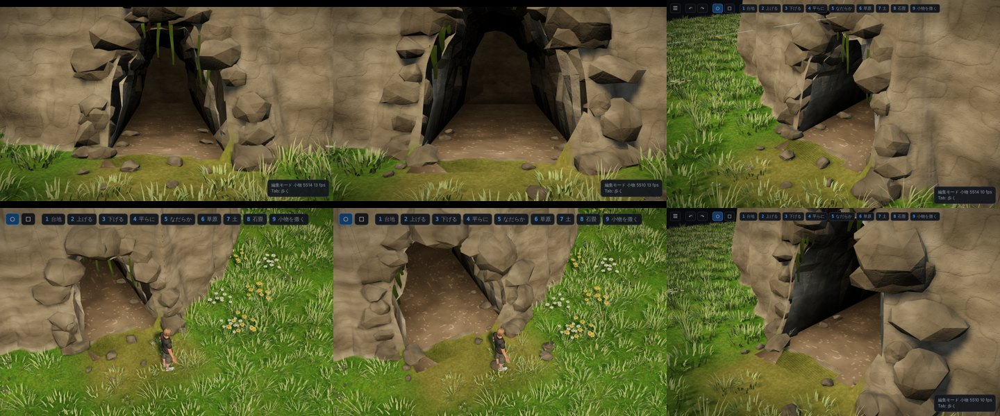

# マップエディター 修正報告（Revision 32）洞窟の入口

ユーザーの依頼：「自然なトンネルというか洞窟も欲しいね。入口だけで良いよ」

## 使い方

- トンネルツール（キー `^`）の見た目に「洞窟」を足しました。
- 掘り方・大きさ・勾配・続き・枝分かれ・出口は、ほかの見た目と同じです。
- 洞窟らしく見えるのは「広い」大きさです。

## 形

- **断面**
  - 人が掘ったアーチではなく、下は切り立ち、上は丸い、ゆがんだ形です。
  - 頂きが片側へ寄り、輪郭はでこぼこします。
  - 形はトンネルごとに違います（トンネルの id から決まるので、保存・読み込みで変わりません）。
  - 高さは「大きさ」の高さ、幅は床の幅の中に収まります。真上から見た左右の位置ごとに天井の高さが 1 つに決まる形にしてあるので、口の地面の切り抜き・地形の穴は、これまでと同じ方法で正確に合います。
- **壁**
  - 素掘りより大きく、細かいでこぼこにしました。
  - 法線を面ごとにして、角ばった岩肌に見せます。色は崖と同じ岩です。
- **暗さ**：入口から 1.5m ほどで暗くなります（ほかの見た目より早い）。灯りは付けません。

## 入口の飾り

| 物 | 置き方 |
|---|---|
| ふちの岩 | 口の輪郭にそって、崖の面へ半分埋める（左右の岩が手前へ張り出して通路のように見えないよう、崖の面より 0.5m までに抑える） |
| 庇の岩 | 口の上に、崖から少し前へ張り出す岩 |
| 鍾乳石 | 口から中へ 1.5m までの天井から。先が床から 2m より下へ来ない長さ。地面の上へ出ている天井には付けない |
| 苔と根 | 口の上の縁から垂れる |
| 落石 | 口の脇に大きめ、前へ小さく散らばる。中の壁ぎわにも少し |
| 口の手前の地面 | 土の道を薄めに塗る |

- 飾りは、これまでと同じく当たり判定のない部分網 `decor` です。
- 書き出しの `meta.tunnels[].styleName` は「洞窟」になります。
- Unity 側の変更はありません（網の形と色で出ます）。

## 確認

- `tests/tunnels_unit.cjs`（16 項目、すべて合格）に洞窟の項目を足しました。
  - 断面の左右が単調で、高さ・幅が大きさどおり。
  - トンネルごとに形が違う。
  - 口の地面が輪郭で切り抜かれる（口の中に三角形が残らない）。
  - 坑口の岩と鍾乳石があり、灯りは無い。
- `tests/tunnels_editor.js`（18 項目）・`tests/springs_editor.js`（14 項目）はすべて合格です。
- 「ふつう」と「広い」の洞窟を、正面・斜め・真上・歩くモードのカメラ・近くから撮って確かめました。
- 読み込みの版を上げたので、完成サンプル（`prepared/`）を作り直しました。`--check` は合格し、ページを開いたときのエラーもありません。
  - 作り方は Revision 31 と同じで、この環境では Playwright のソフトウェア描画を使っています。

## 今回やっていないこと

- 洞窟の奥（依頼どおり入口だけ）。
- 洞窟の床の起伏（歩く床は平らなまま。見た目の土と小石だけ）。
