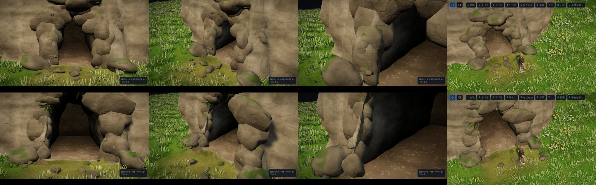

# マップエディター 修正報告（Revision 33）洞窟の入口のブラッシュアップ

ユーザーの依頼：「洞窟に関して、もう少し幾何学的な線を無くしたいですね。ブラッシュアップ、クオリティアップをお願いします。」

## 直線・平らな面が出ていた所と、直し方

| 前 | 後 |
|---|---|
| 壁が平らな三角形の集まり（面ごとの法線） | 大きなうねり・こぶ・細かい凹凸を重ねたふくらみにし、法線はでこぼこした形そのものから求めます（なめらか） |
| 床と壁の境がまっすぐな一本の線 | 壁の足もともふくらませて、境を波打たせます。壁ぎわには、口の外から中 3m まで大小の石を並べます |
| 口の縁が、崖を断面で切った縦の直線 | 口のまわりの地面を、壁と同じふくらみで切り抜きます（縁の線が、壁と同じに波打つ） |
| 岩が二十面体の角ばった面 | 320 面の丸く風化した岩（重ねたむらでゆがめる）。上を向いた所に苔 |
| 丸い岩が口の両脇に縦に積み重なる | 口のまわりは、崖の面にそって平たくつぶした「岩肌の張り出し」にし、口の縁にまたがって置きます。ばらばらの大岩は足もとに 1〜2 個ずつ |
| 苔が一本ずつのまっすぐな帯 | 何本かずつの束で、ゆるく曲がって垂れます。細い根の線はやめました |
| 口の前で、床の縁がまっすぐ横切る | 口の外の床の端を地面の下へもぐらせます（全種類） |
| 口の縁に、青白い縦の帯 | 屋根を透かしたときの切り口の面（壁の外側から地面のすぐ下まで立てる面）が、崖の近くで地面の上へ出ないよう、地面で切り落とします。口のすぐ内側の壁を明るくしすぎていたのも直しました |

- 洞窟の壁・岩には、遺跡と同じ苔（上を向いた面）が付きます。
- 地形の穴・口のまわりの地面の切り抜きは、これまでどおり正確です。単体試験では、壁のふくらみ（最大 0.4m）より内側に、地面の三角形が残らないことを確かめています。

## 確認

- `tests/tunnels_unit.cjs` 16 項目、`tests/tunnels_editor.js` 18 項目、`tests/springs_editor.js` 14 項目は、すべて合格です。
- 「ふつう」と「広い」の洞窟を、正面・斜め・近く・歩くモードのカメラ・中から屋根を透かした所で撮って確かめました。
- 網を 1 つずつ隠して撮り比べ、縦の帯の原因（トンネルの壁の網）を特定しました。
- 上流のコミット bfc47bd（保存と書き出しの分離）の上に載せ直しました。その時点で完成サンプルの照合がまた合わなくなっていたので、作り直しました（`--check` 合格、ページのエラーなし）。

## 負荷

- 洞窟の口 1 つあたりの飾りは、約 1.6 万三角形です（丸い岩が 320 面のため）。60m のトンネル 4 本でも、網づくりは 1 秒以内です（単体試験の速さの項目）。
