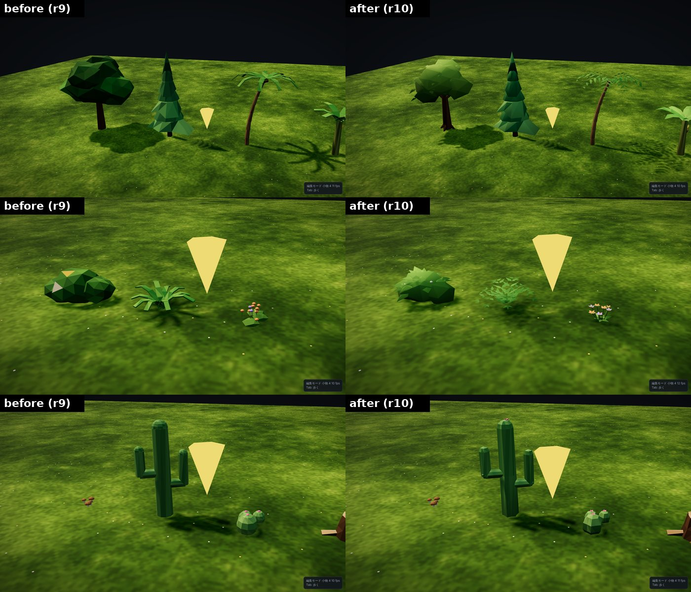
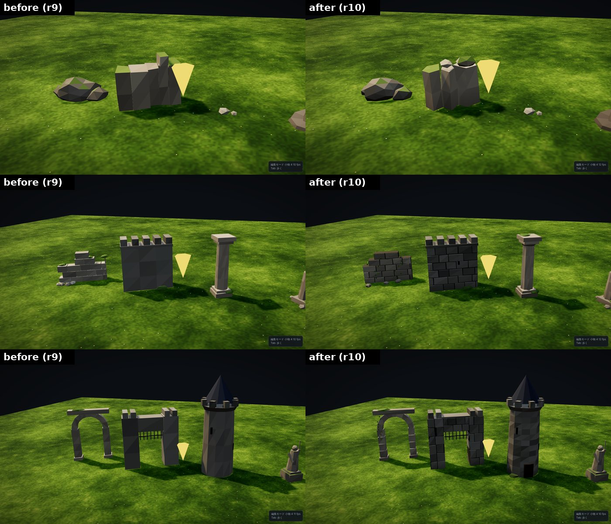
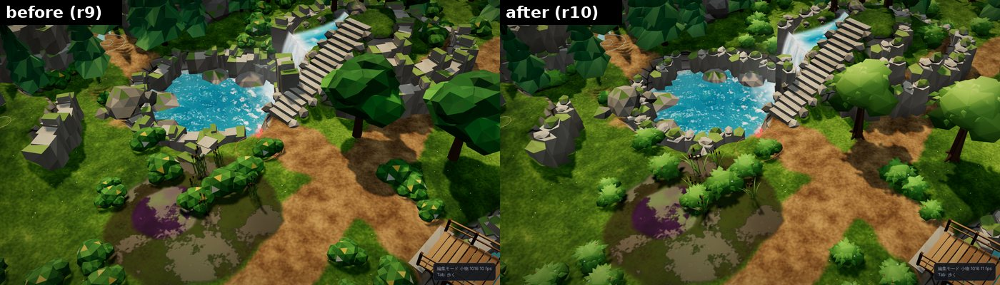

# マップエディター 修正報告（Revision 9）植物・岩・壁の見た目

植物・岩・壁などの小物の見た目を作り直しました。植物は、ひと目で植物と分かることを優先しています。スマホ ARPG のマップとして軽さを保つため、テクスチャは使わず、頂点色だけの低ポリゴンのままです。描画の回数（小物の種類ごとに 1 回のインスタンス描画）も変わりません。

- 変えたのはエディターの画面の見た目だけです。Unity 向けの書き出しは 1 バイトも変わりません（下の「確認結果」）。
- `exporterVersion` は `tdj-map-editor/2026.10.19-r9` のままです（出力が同じため）。
- 確認はエディター側（ヘッドレス Chromium）で行いました。Unity 側の Prefab は、この修正の対象外です。

## 植物

- 葉を「葉の形」で作りました。
  - 葉は、根元・葉脈・先端を持つ菱形の板です。中央の葉脈を少し持ち上げ、先を垂らしています。
  - 細長い葉（バナナ・葦）は、葉脈にそって曲がる帯で作りました。
  - 葉は両面に面を持つので、裏から見ても欠けません。
- 柔らかい陰影にしました。
  - 樹冠・茂み・葉の法線を、株の中心から外向きに曲げています。面ごとのカクカクした陰影ではなく、ひとかたまりの丸い明暗に見えます。
  - 植物だけ、なめらかな陰影の材質（`foliageMat`）を使います。
  - 高い木（広葉樹・針葉樹・ヤシ・バナナ）は、樹冠が自分自身に落とす影を受けません。でこぼこの樹冠がまだらに暗くなるのを防ぐためで、そのぶん描画も軽くなります。地面へ落とす影は今までどおりです。
- 種類ごとの変更：

| 小物 | 変更 |
|---|---|
| 広葉樹 | 根の張り出し・枝を追加。樹冠は上が明るい黄緑、下が暗い緑。葉を 34 枚付けて輪郭を崩した |
| 針葉樹 | 幹を作り直し、段の陰影を柔らかくした |
| 茂み | 葉 26 枚と、白・赤の小さな花（実） |
| シダ | 羽状の葉。先へ行くほど小さくなる小葉を、9 本の葉に並べた |
| 花 | 根元の葉のロゼット、茎、5 枚の花びらと花芯 |
| 葦 | 葉を細長い帯にし、穂の先に芯を付けた |
| ヤシ | 小葉の並んだ葉、節のある幹 |
| バナナの木 | 大きく垂れる葉、実の房、紫のつぼみ |
| サボテン・丸サボテン | 縦の溝（稜）と、てっぺんの花 |
| きのこ | 赤い傘に白い斑点、傘の裏のひだ |
| 倒木・切り株 | 樹皮の溝、切り口の年輪、苔、小さなきのこ |
| 枯れ木 | 枝分かれした枝と根 |

## 岩

- 岩・小石・溶岩岩・氷塊は、平面で何度か削った形にしました。丸い塊ではなく、割れ面と稜線のある石に見えます。三角形の数は前と同じです。
- 岩には地層の帯、上を向いた面には明るい色と苔を付けました。
- 崖石（岩壁）は、太さの違う五角柱を並べた形にしました。
  - 柱の段ごとに出入りを付けたので、地層の段が見えます。
  - 上面の一部には草が生えています。
  - 地面に埋まる底面は作らないので、軽くなっています。
- 岩・崖石の種類ごとの色（岩壁の塗り分け、Revision 7）は、今までどおり効きます。

## 壁・建物

- 壁は、石を 1 個ずつ積んで作りました。
  - 崩れた壁と城壁は、半分ずらした石積みです。目地は、後ろにある暗い芯が見えることで表しています。
  - 崩れた壁は上が欠け、苔とツタが付いています。
- 城門は、左右の塔と上の梁を石積みにしました。
- 塔は、石ごとに色を変えて石積みに見せました。入口の扉と、とんがり屋根の縞も付けました。
- 石柱・折れた石柱には、縦の溝（フルーティング）を付けました。アーチ門の柱は石を積んだ形にし、ツタを付けました。
- 根元を少し暗くしたので、小物が地面に置かれているように見えます。暗くする量は頂点色に書き込んでいるため、描画の負荷は増えません。

## 軽さ

- テクスチャ：0 枚のまま。小物は頂点色だけで描きます。
- 描画の回数：小物の種類ごとに 1 回のインスタンス描画のままです。材質は 1 つ増えました（植物用）。
- 三角形の数（1 個あたり）：

| 小物 | 前 | 後 | 小物 | 前 | 後 |
|---|---|---|---|---|---|
| 針葉樹 | 288 | 276 | 広葉樹 | 504 | 576 |
| 茂み | 320 | 300 | シダ | 480 | 468 |
| 花 | 432 | 286 | 葦 | 316 | 396 |
| ヤシ | 716 | 676 | バナナの木 | 384 | 318 |
| サボテン | 370 | 280 | 丸サボテン | 360 | 348 |
| きのこ | 220 | 208 | 枯れ木 | 156 | 176 |
| 倒木 | 184 | 284 | 切り株 | 154 | 238 |
| 岩・小石・溶岩岩・氷塊 | 同じ | 同じ | 崖石 | 112 | 130 |
| 石柱 | 188 | 264 | 折れた石柱 | 216 | 264 |
| 崩れた壁 | 368 | 528 | アーチ門 | 236 | 300 |
| 城壁 | 152 | 484 | 塔 | 336 | 536 |
| 城門 | 212 | 576 | | | |

- 部屋全体の三角形の数：

| | 小物の数 | 前 | 後 |
|---|---|---|---|
| サンプル1（64m） | 1,025 | 167,012 | 176,638（+5.8%） |
| サンプル2（48m・遺跡） | 384 | 59,054 | 66,608（+12.8%） |

- 増えた分の大半は崖石です（1 個あたり +18、サンプル1 では 609 個）。数の多い草木（針葉樹・茂み）は、前より少し減らしました。
- 城壁・城門・塔は 1 個あたりの三角形が増えましたが、置く数が少ない大きな建物です。

## 書き出しへの影響

- `asset_catalog.json` の `height`（当たり判定の上端）は、前の見た目から測った値をそのまま使います（`PROP_HEIGHT`）。
  - 見た目の高さの差は、多くの小物で数 cm です。大きいものでもシダ +13cm、広葉樹 −20cm です。
  - これで、カタログと、橋・階段の上の障害物の判定が変わりません。
- 見た目の上端は、確認用に `t.meshTop` として持っています。

## 確認結果

- 書き出しが変わらないこと：
  - 2 つのサンプル（`samples/` の map.json を読み込み）を、前（r9）と後で書き出して比べました。
  - 全ファイル（22 個・21 個）が同じで、違うのは manifest.json の `exportedAt`（書き出した時刻）だけです。
  - contentHash も一致しました。
- 既存のテスト：RESULTS_LINE
- 画面のエラー：0 件。
