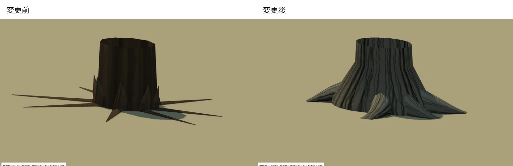
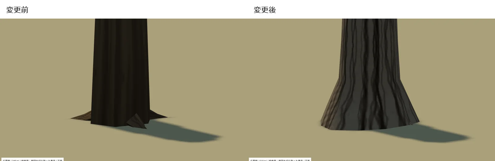
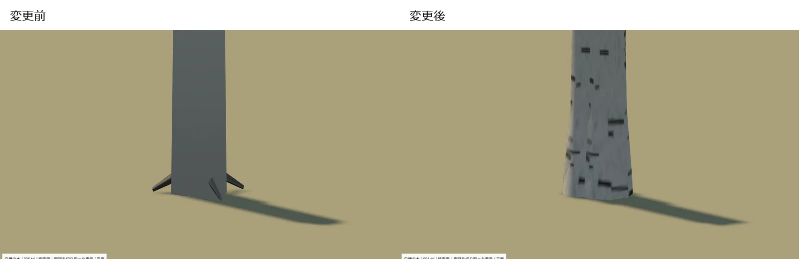
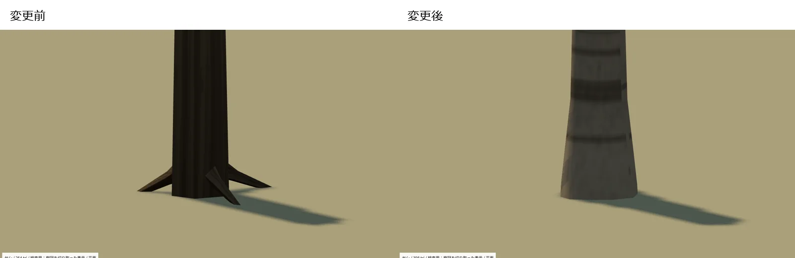

# 樹木の根元・幹の質感改善

2026-10-22。樹木比較の基準は `24897c5`。公開時は先行main `a558c03` の崖の上下重ね・経路保護を保持して統合した。全96種のID・配置寸法・原点・保存形式を維持し、立木・木質低木24モデルを監査・改善した。バナナも既存の木カタログとして含めた。茂み `bush`、つる茂み `bramble`、ツタ `ivy` は露出した棘状根を持たず、今回の変更対象にしていない。

[根元の確認画面](../tests/tree_roots_view.html) / [樹冠・風の一覧](../tests/tree_view.html) / [本体](../index.html)

## 見た目の修正

旧22モデルにあった細い円錐根・薄い板根を除き、幹の裾から連続して広がる根張りへ変更。主根が必要な木には曲がりと厚い断面を持つ少数の根を、幻想樹には厚い板根を設けた。根先を細い一点へ絞らず、低く幅を残して地面へつなぐ。ヤシは丸い基部、バナナは葉鞘、低木は小さい株元とし、全木に板根を付けていない。

幹は8〜24角の断面と滑らかな曲がり・法線を使い、下部の膨らみと陰影を整理した。9系統の自作手続き樹皮を既存1024×512アトラス内で共用。縦裂け・繊維・鱗状・剥離斑・横皮目・葉痕・白樺・滑らかな木肌・葉鞘を区別し、幹と根の流れにUVを割り当てた。縦方向の折返しは端の画素を合わせ、露骨な横の継ぎ目を抑えた。グローバル照明は変更していない。

樹冠の三角形・色・法線・UV・可動ウェイトと、既存の枝経路・風/接触設定は保存。龍血樹の反復分岐・浅い天蓋、花畑配色、林床、水、主人公、地面、UI/崖機能も保全した。

## 全対象と予算

全モデル1材質のまま。画像枚数7枚、樹木画像1024×512、RGBA8＋ミップ約2.67 MiBは据え置き。樹木アトラスPNGは212,077→317,235 bytes（+105,158）。葉・花・ヤシ葉・龍血樹葉束の画素は変更していない。その他6画像と対象外25共有モデルは一致する。

24モデル各1個の合計は10,059→16,205三角形（+6,146、+61.1%）、頂点は20,660→19,704。世界樹は801→1,788三角形。根の断面・曲率へ増分を割り当て、隠し影モデル・追加描画パスは増やしていない。配置数に比例して三角形・影の処理は増える。共有データは8,055,159→8,209,416 bytes、zlib圧縮は1,988,113→2,147,044 bytes（HTTP転送量そのものではない）。

| 対象 | 根の扱い | 樹皮 | 三角形 前→後 |
|---|---|---|---|
| 針葉樹 (`pine`) | 裾から連続する根張り | scaly | 497 → 713 |
| 白樺の木 (`birch`) | 裾から連続する根張り | birch | 395 → 601 |
| しだれ柳 (`willow`) | 根張り＋湾曲した主根2本 | furrowed | 456 → 750 |
| 傘形の松 (`scotspine`) | 根張り＋湾曲した主根2本 | scaly | 386 → 656 |
| 株立ちの低木 (`hazel`) | 低い株元 | smooth | 200 → 360 |
| 実付きの小高木 (`rowan`) | 裾から連続する根張り | smooth | 377 → 497 |
| 地を這う針葉低木 (`juniper`) | 低い株元 | fibrous | 130 → 130 |
| 紅葉のモミジ (`maple`) | 裾から連続する根張り | smooth | 386 → 530 |
| 桜 (`cherry`) | 裾から連続する根張り | cherry | 386 → 530 |
| ケヤキ (`zelkova`) | 根張り＋湾曲した主根2本 | peeling | 483 → 801 |
| ナラ (`nara`) | 根張り＋湾曲した主根2本 | furrowed | 423 → 717 |
| スギ (`sugi`) | 裾から連続する根張り | fibrous | 645 → 909 |
| ヒノキ (`hinoki`) | 裾から連続する根張り | fibrous | 571 → 811 |
| シマトネリコ (`islandash`) | 裾から連続する根張り | smooth | 445 → 757 |
| オリーブ (`olive`) | 根張り＋湾曲した主根2本 | furrowed | 434 → 712 |
| ユーカリ (`eucalyptus`) | 裾から連続する根張り | peeling | 379 → 595 |
| 龍血樹 (`dragontree`) | 裾から連続する根張り | smooth | 669 → 765 |
| エルフの森の木 (`elftree`) | 厚い非均等の板根 | furrowed | 507 → 1068 |
| 世界樹 (`worldtree`) | 厚い非均等の板根 | furrowed | 801 → 1788 |
| 広葉樹 (`oak`) | 根張り＋湾曲した主根2本 | furrowed | 349 → 619 |
| ヤシ (`palm`) | 繊維根型の丸い基部 | palm | 254 → 398 |
| バナナの木 (`banana`) | 葉鞘型の基部 | sheath | 238 → 358 |
| 枯れ木 (`deadtree`) | 根張り＋湾曲した主根2本 | furrowed | 276 → 498 |
| 異形の木 (`twisttree`) | 根張り＋湾曲した主根2本 | furrowed | 372 → 642 |

## 同一条件の比較

ユーザーPCのChrome（SwiftShader）で同じカメラ・光を使用。真上、根元近接、低い人間目線、樹皮近接、10%の平面斜面を全24モデルで記録した。根元専用モードは検査のため上部をクリップしており、実モデルの切断ではない。人物は1.8mの検査用カプセル。本体の主人公を使う混在林・歩行検査も実施する。

全対象の根元・低い視点：[比較1](images/root-bark-audit-0.webp) / [比較2](images/root-bark-audit-1.webp) / [比較3](images/root-bark-audit-2.webp) / [比較4](images/root-bark-audit-3.webp)。各対象の左が変更前、右が変更後。

## 緩斜面と共有経路

根先の浮きを減らすため、根元だけに最大勾配0.15（約8.5度）の局所平面補正を追加。上部の幹と樹冠は直立し、原点・保存座標・地形は移動しない。高さ固定の配置は補正しない。根元の可動ウェイトは風/接触とは別で、風が吹いても根や幹は揺れない。平面での補正は厳密に0。

ブラウザは配置/地形の再構築時に4回の高さサンプルを取り、1配置あたり2 floatの傾斜を更新する。全頂点の毎フレームCPU更新はない。頂点に1 floatの静的重みを追加し、同じ頂点変形を本体・ゴースト・影で使う。ゴーストは静的メッシュバッファを共有する。

`map.json`・`props.csv`の形式を変えず、任意の `root_grounding.json`（version 1、Unity world XZ、instanceId別の傾斜）をエクスポートする。エディタZからUnity Zへの符号反転を含む。共有モデルの任意 `rootWeights` / `rootGrounding` と更新済みUnityインポーターを組にして使う。旧v2〜v7は任意データがなくても静止補正0で読める。非均等縮尺の描画範囲も補正し、接触のRefresh後に保持する。UnityはUV4と `_TDRootSlope` を使い、風・接触のプロパティを上書きしない。Unity内で移設する場合は `SharedRootGrounding.SetSlope(renderer, slope)` と既存接触のRefreshを明示的に呼ぶ。ゲーム本体への自動組み込み・Terrainの常時走査は追加していない。

## 参照と素材の由来

写真を画像素材にせず、樹皮の方向・明暗・剥がれ方の照合だけに利用。画像はすべて `tools/plants/root-bark.js` のCanvas描画から生成する。参考写真をリポジトリへ同梱・再配布していない。

- 根張り：[University of Minnesota](https://extension.umn.edu/garden-and-home/yard-and-garden/gardening-in-minnesota/planting-and-transplanting-trees-and-shrubs)、[Wisconsin Extension](https://hort.extension.wisc.edu/articles/5-steps-to-plant-a-tree/)。幹の裾と地表へ続く根を区別した。
- スギ・ヒノキ：[NC State スギ](https://plants.ces.ncsu.edu/plants/cryptomeria-japonica/) / [ヒノキ](https://plants.ces.ncsu.edu/plants/chamaecyparis-obtusa/)。繊維状の木肌を参照。
- モミジ・桜・白樺：[モミジ](https://plants.ces.ncsu.edu/plants/acer-palmatum/) / [桜](https://plants.ces.ncsu.edu/plants/prunus-serrulata/) / [白樺](https://plants.ces.ncsu.edu/plants/betula-pendula/)。滑らかさ、横皮目、白い木肌を分けた。
- ケヤキ・ナラ：[Oregon State ケヤキ](https://landscapeplants.oregonstate.edu/plants/zelkova-serrata) / [コナラ（Q. serrataの異名を掲載）](https://landscapeplants.oregonstate.edu/plants/quercus-glandulifera)。剥離斑と割れを区別。
- オリーブ・松：[NC State オリーブ](https://plants.ces.ncsu.edu/plants/olea-europaea/) / [ヨーロッパアカマツ](https://plants.ces.ncsu.edu/plants/pinus-sylvestris/)。古い樹皮の割れと鱗状の違いを参照。
- シマトネリコ：[兵庫県立淡路景観園芸学校の現物記録](https://www.awaji.ac.jp/migoroarchive/1507/05.html)。若い木の白味のある平滑な木肌を採用。
- ユーカリ：[Australian National Botanic Gardens](https://www.anbg.gov.au/gnp/cold-climate/eucalypts-cold-climates.html)。属内の差が大きいため、今回の既存モデルは灰白色の平滑・剥離型を参照し、全種共通の樹皮とは扱わない。補助のEuclid本文1ページはHTTP 403で読めず、迂回取得していない。
- バナナ：[NC State Musa basjoo](https://plants.ces.ncsu.edu/plants/musa-basjoo/)。木質樹皮ではなく重なった葉鞘の仮茎として区別。
- 龍血樹は[前回確認した写真資料](DRAGON_REFERENCE.md)も継続参照。幻想樹、枯れ木、異形の木、汎用の広葉樹等はゲーム用の創作表現であり、実物の測量モデルではない。

## 検証と制限

- ソース1,095項目：寸法・原点・ID・材質・既存樹冠/枝・根幹固定・面向き/法線・保護画像を検査。
- 本体208項目：96種、旧版マップ、配置/削除/回転/縦縮尺、保存読込、26配置の書き出し。
- GPU：既存37可動資産の風/接触、24樹木の斜面補正と回転/非均等縮尺を実WebGLで検査。平面の静止基準、時間差・配置差・固定点を確認。
- 本体斜面96ケース：24種×4勾配。手動高さ・ゴースト・15%上限・保存再読込・24配置のUnity Z反転を検査。
- 隔離Unity6000.5.9f1 / URP / D3D11：320項目、旧v2〜v7、49資産/26配置、UV・GPU一致・風接触/復帰・影・全24種の平面/緩斜面実描画を確認。実エクスポートからの斜面受け渡し・接触との共存/復帰は追加98項目を通過。本体の全24種で無風・そよ風・強風、歩行接触・連続接触の上限・離脱後の完全復帰・CPU頂点更新なしを確認。484配置・2,400接触ステップでは最大候補27、PCのバッチ合計8.7ms（描画FPS/スマホ測定ではなく、短いステップの個別時間は計時分解能未満）。

局所的な平面補正なので、急斜面・段差・根元の幅内で強く曲がる地形には完全追従しない。15%を超える傾斜では浮き/埋まりが残り得る。小縮尺時の枝下高低下、根の詳細外形と既存の簡易幹コライダーとの差は維持。スマホ実機性能、ゲーム本体統合、Unity Built-inは未検証。既知のD3D12終了時クラッシュの原因も未確定。描画コストの数値からスマホ動作を保証しない。

## 再生成

`node tools/plants/bake_roots.cjs`、一致検査は `--check`。樹冠の一括再生成も最後に根・樹皮のレイヤーを適用する。旧植物/林床の生成器は新しい樹木資産を上書きしない。検査は `tests/root_bark_source.py`、`root_bark_validation.cjs`、`root_bark_gpu.cjs`、`root_bark_ground.cjs`、`tree_roots_review.cjs` と既存 `tree_gpu.cjs` / `tree_motion.cjs`、Unityの `TreeCanopyChecks` / `RootBarkTransportChecks`。

撮影時に並行テストがデバッグ用ポートへ接続する競合も見つかったため、検査用ChromeはOS割当の専用ポートを使い、意図しないページ遷移・接続切断・コマンド待ち超過を検査失敗にする。誤った対象へ遷移したモーション撮影は採用せず、全24種を再撮影した。

世界樹の太い主根には既存の簡易幹コライダーの外へ出る部分がある。見た目の根と詳細な歩行/接触用コライダーを一致させる実ゲーム統合は今回行っていない。単独の露出根・切株は旧カタログの別モデルとして保全した。
