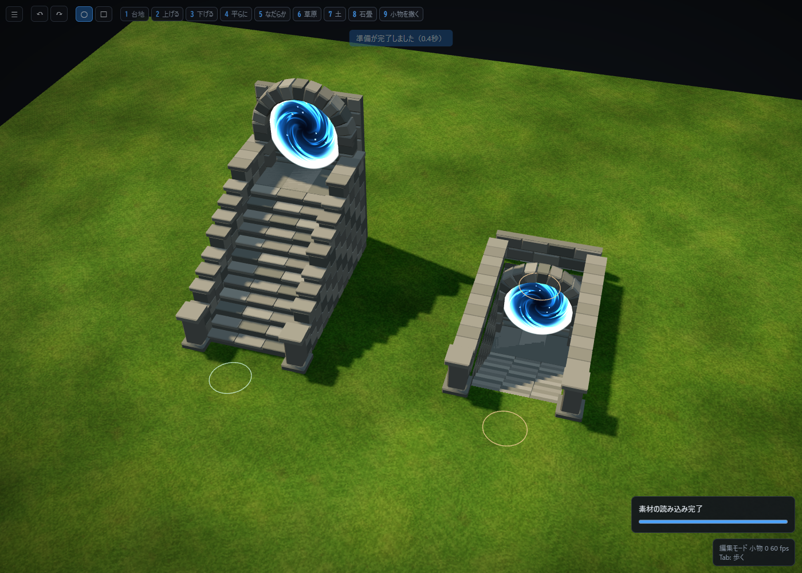

# 上り・下り階段の内部通行（2026-11-07）

## 変更

階層移動用の「上り階段」「下り階段」を、面取りした敷石、石積みの側壁、笠石、入口柱、石造アーチと踊り場のある構造へ更新しました。1段20cm、12段で高低差2.4m、段の奥行30cm、内幅2.2mです。上り・下りとも、入口から奥の踊り場へ入り、引き返せます。

下り階段の中央を塞いでいた円形の障害物を除去し、実際の段と同じ下降床を追加しました。側壁・背面は引き続き通り抜けできません。階層移動の判定位置は階段の奥へ移しました。入口へ戻る位置は地上に保持しています。

既存のID、保存形式、配置の回転、カスタム資産対応表を維持しています。既存の階段配置にも新しい造形を使いますが、奥行きが増えたため、既存マップで奥側に他の建物や壁が密接している場合は間隔を確認してください。カスタム対応表で階段の当たり判定を上書きした場合、その指定を優先します。

## 描画とUnity出力

- 上り8,604三角形、下り9,444三角形。石材は各4メッシュに統合し、石1個ごとの描画を避けています。
- 壁芯があるため、石の目地から地面が透けません。
- `meta.json` の `floorStairsV1` にWebと同じ石材メッシュ、法線、材質、ポータル位置を出力します。階段がないマップには追加しません。
- 地形の穴は従来の `holes.png` と `floorLinks[].pitHoleCells` で出力します。下り階段をUnityに置く場合、地形側でもこの穴の反映が必要です。
- `unity/Assets/MapFloorLinks` をUnityへ入れ、`Tools → Map Editor → Import floor stairs` でUnity書き出しフォルダーを選びます。2種類のPrefabと配置を生成します。毎回別の生成フォルダーへ保存し、既存資産を上書きしません。
- 青い渦のポータルも専用Shaderで表示します。ポータル面に衝突は付けません。
- Unityの衝突は見た目と同じ石造メッシュです。階層移動イベントは接続先ゲームの実装事項であり、自動的に別の階をロードする仕組みは追加していません。

## 検証

`node tests/stair-interiors.cjs` で以下を確認しています。

- 上り・下り × 回転0/37/90度の6条件で、実際の歩行更新を使って奥まで入り、地上へ戻る。
- 下降床・上昇床の高さ、側壁による停止、中心通路の連続性。
- 保存再読込、有限な頂点と法線、石材の4メッシュ化、WebGLエラー0。
- Unity用の実書き出し、下り階段の地形穴、正面・背面・俯瞰の描画。

保存・アーカイブ・境界・衝突データ・橋上/橋下通行の既存テストも成功しています。

Unity 6000.6.8f1の専用レビュー環境で、CharacterController（半径0.22m、高さ1.7m、stepOffset 0.3m）を使用して6配置・12方向の往復を検証。踊り場の±2.4m、地上の0mへの復帰、Prefab/Scene保存再読込を確認しました。最終版ではポータル無衝突、Built-in/URP両方の12画像、Shaderエラーなしを追加確認しています。Unity SearchDatabaseの既知の起動時例外1件はログにありますが、検証は完遂し終了コード0でした。Player buildは実施していません。

## 本体ゲームへの取り込み

今回のUnity確認は専用の隔離プロジェクトで実施しています。本体ゲームの共有Scene・Prefabは担当予約が必要なため、未予約のまま変更していません。ゲーム本体への接続、地形インポートとの統合、階層移動イベントの接続は、担当との調整後に行う必要があります。
