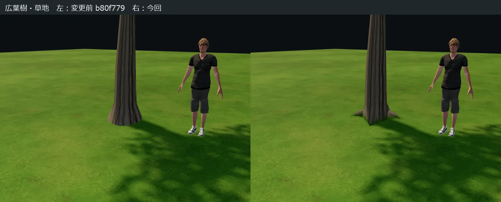
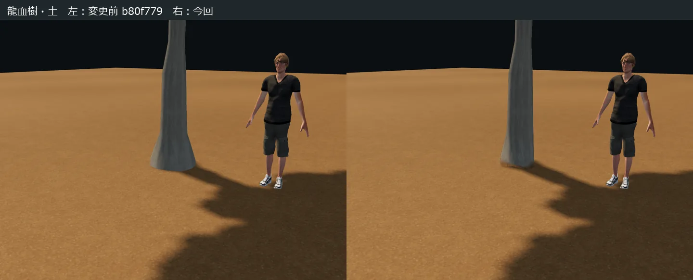
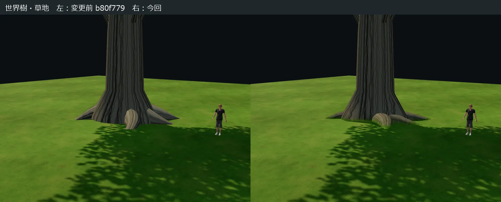
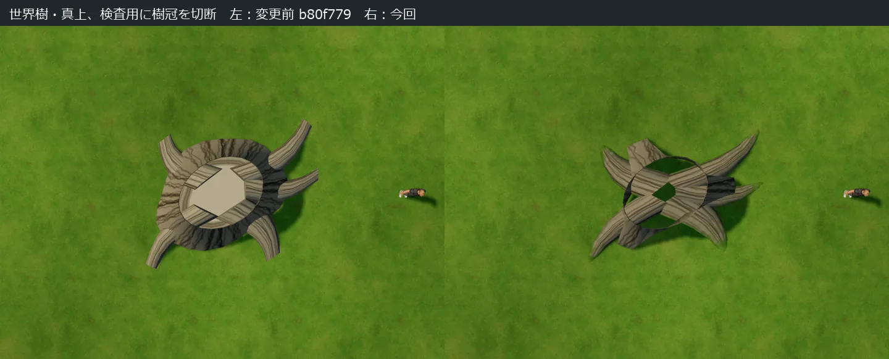

# 樹木の地面との接続改善

基準は公開済み `b80f779`。エディタ本体の材質・地面・人物を使い、同じカメラと照明で比較した。通常木と龍血樹の一様な裾、世界樹の短い露出端を確認し、地際の輪郭・根の流れ・表面の遷移を組み合わせて修正した。試験の合格を美観の承認とは扱っていない。

[実エディタを使う接地確認ページ](../tests/tree_ground_contact.html)では24対象、草地／土／瓦礫、標準／0.7／1.3倍、10%斜面、隣接配置、真上と低視点を切り替えられる。「根元のみ」は樹冠を切る検査表示で、開いた切断面が見える。通常の本体に切断や専用UIは追加していない。

## 比較

各画像は左が変更前、右が今回。人物は標準1.8 m。下の真上比較だけは検査用の樹冠切断を使う。

## 実装

- 幹の裾を不均等にし、曲がった主根の厚みを保ちながら終端を地中へ続けた。短い露出端に見えた世界樹の根は長さと高さを調整。細身の枯れ木・異形木は従来の横幅に収めた。
- 原点・配置座標・地上の最高点・XZ設置範囲・ID・カタログ96種を保持。地中の底面だけ局所的に2.5〜20 cm伸ばした。木全体の下方移動や地形の盛り上げはしていない。ジュニパーは従来形状を維持し、木質部分の表面処理のみ対応する。
- 根と幹のマスクで葉・花・樹冠を除外し、地際の短い帯に既存の草・土画像と不規則な汚れ・苔・控えめな減光を混合。材質は従来の拡散照明を維持し、新しい粗さ画像やPBR化は行っていない。
- 接地点の塗りから草・土・瓦礫を区別。雪など未対応の塗りには草色を付けない。低い帯の法線と数cmの不規則な切り欠きも表面・影の両方に反映する。円盤、デカール、透明な地面パッチは増やしていない。
- 既存の15%上限の局所斜面追従を維持。地面の塗り情報は配置・地形再構築時に更新し、頂点を毎フレームCPUで書き換えない。風・接触の重み、根幹固定、樹冠・枝の位置と色は保全。
- ブラウザとUnityは同じメッシュ、木質マスク、地際パラメータ、4 mの草・2 mの土画像を使用。`root_grounding.json` に任意の地面情報を追加し、マップ本体とCSVの形式は変更しない。旧出力では追加の色混合を無効にする。
- 隔離Unityの共有地面には主光の影を受け取る処理を補った。地面の色・画像・倍率、グローバル照明、水やゲーム本体には変更を加えていない。

## 形状と負荷

対象 | 三角形数（変更前 → 今回） | 地中底面の追加深さ m
--- | ---: | ---:
| 針葉樹 (`pine`) | 713 → 761 | 0.055 |
| 白樺の木 (`birch`) | 601 → 665 | 0.055 |
| しだれ柳 (`willow`) | 750 → 792 | 0.065 |
| 傘形の松 (`scotspine`) | 656 → 698 | 0.065 |
| 株立ちの低木 (`hazel`) | 360 → 424 | 0.025 |
| 実付きの小高木 (`rowan`) | 497 → 545 | 0.055 |
| 地を這う針葉低木 (`juniper`) | 130 → 130 | 0 |
| 紅葉のモミジ (`maple`) | 530 → 578 | 0.055 |
| 桜 (`cherry`) | 530 → 578 | 0.055 |
| ケヤキ (`zelkova`) | 801 → 843 | 0.065 |
| ナラ (`nara`) | 717 → 759 | 0.065 |
| スギ (`sugi`) | 909 → 957 | 0.055 |
| ヒノキ (`hinoki`) | 811 → 859 | 0.055 |
| シマトネリコ (`islandash`) | 757 → 853 | 0.055 |
| オリーブ (`olive`) | 712 → 770 | 0.065 |
| ユーカリ (`eucalyptus`) | 595 → 643 | 0.055 |
| 龍血樹 (`dragontree`) | 765 → 813 | 0.055 |
| エルフの森の木 (`elftree`) | 1068 → 1101 | 0.085 |
| 世界樹 (`worldtree`) | 1788 → 1859 | 0.2 |
| 広葉樹 (`oak`) | 619 → 661 | 0.055 |
| ヤシ (`palm`) | 398 → 446 | 0.055 |
| バナナの木 (`banana`) | 358 → 406 | 0.055 |
| 枯れ木 (`deadtree`) | 498 → 540 | 0.055 |
| 異形の木 (`twisttree`) | 642 → 684 | 0.055 |

24対象の合計は16,205 → 17,365三角形（+1,160、約7.2%）、19,704 → 20,262頂点。世界樹は1,788 → 1,859三角形。各1材質・既存の描画パス数を維持し、共用画像7枚はバイト単位で変更なし。本体の代表1本の比較では、全体11描画を維持した。表示される地形・人物を含む値である。

根元の前方描画は既存アトラスに草・土の2サンプラーを追加し、近い木質部分で最大4回の画像参照を使う。影は画像参照数を増やさず、地際の切り欠きを揃える。追加の透明面や透明ブレンドによる重ね描きはないが、GPUの演算・頂点帯域・地際の破棄処理は増える。実機でのフレーム時間は未測定。

ブラウザの草・土画像は地形用のGPU画像を再利用する。追加属性は木質マスク約79 KiBと、24種×8,256予約枠の地面情報約3.02 MiB。Unityで物体のみを新規取り込みすると、草512²・土256²の共有画像（非圧縮RGBA＋ミップで計約1.67 MiB）が追加される。1本ごとの画像複製はしない。マテリアルプロパティブロックによるSRP Batcherへの影響も含め、Unityの描画時間は測定していない。

共有データは8,209,416 → 8,337,947 bytes、zlib圧縮で2,147,044 → 2,175,679 bytes。このページ用の比較画像4枚は合計167,460 bytesで、エディタ本体からは読み込まない。

## 検証

- 形状・保全1,857項目：24対象の頂点／法線／マスク、三角形の向きと非退化、固定根幹、25個の対象外モデルと全画像、既存の枝葉の属性を比較。
- 本体208項目：登録96種、旧配置、24対象の選択・配置・削除・回転・縦横拡縮・保存再読込、共有出力。
- 全24対象の実エディタ低視点・根元真上を撮影。草／土／瓦礫×0.7／1／1.3倍の隣接配置・10%斜面・再読込・樹冠透過側の地面情報を確認。真上はカメラ方向でも90度を検査。
- WebGL2の37可動資産と24根元のGPU変位、4斜面×24対象、無風／そよ風／強風、歩行接触・上限・離脱復帰・CPU頂点非更新を確認。接触CPUのみの測定はPC上の484配置・2,400更新で平均約0.002 ms、候補最大27。ソフトウェア描画のChromeを用いた検査であり、GPUやスマホの速度を示す値ではない。
- Unity 6000.5.9f1・URP・D3D11の隔離環境で320項目と追加173項目。共有取り込み、旧v2〜v7、GPU変位、影、地際情報の受け渡しと接触後の保全、非均一拡縮の描画境界を確認。草／土／瓦礫・混合・無効×高さ6段階×木質／葉の60点の共通色処理は、ブラウザとの最大線形RGB差0.0000673。
- 比較専用シェーダーの入力定義不足を検出・修正してから上記のGPU比較を通した。製品の色を差に合わせて誤変換していない。
- 並行の崖機能は277件の加工・554記録の保存再読込と単体検査を通過。水、主人公、花畑、保存IDは変更していない。

再現用：`tests/tree_contact_source.py`、`tests/root_bark_validation.cjs`、`tests/tree_contact_browser.cjs`、`tests/root_surface_parity.cjs`、`tests/tree_gpu.cjs`、`tests/root_bark_gpu.cjs`、`tests/root_bark_ground.cjs`、`tests/tree_motion.cjs`。Unityは `TreeCanopyChecks.Run -root-surface-checks` で追加検査も実行する。テスト参照出力と元PNGは公開ファイルに含めない。

## 制限

地面追従は近傍4点の平面近似で、急斜面、崖や急な折れ曲がり、根の広い世界樹の非平面地形では完全には一致しない。地面の塗りは配置中心を参照するため、広い根が草・土の鋭い塗り境界を跨ぐ場合の色は近似になる。瓦礫の色も既存画像の転用ではなく控えめな手続き近似。草の生えていない全バイオームに苔を強制しない。

小縮尺で枝下が1.8 m未満になる既存の制限、幹の簡易当たり判定と大きな根の輪郭の差は継続する。スマホ実機・ゲーム本体への組み込み・Built-inの実描画は未検証。既知のD3D12終了時クラッシュは原因未確定のままで、今回のD3D11検証で解決したとは扱わない。
